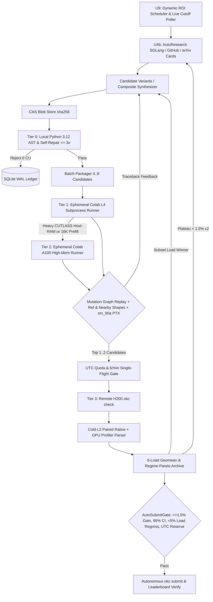
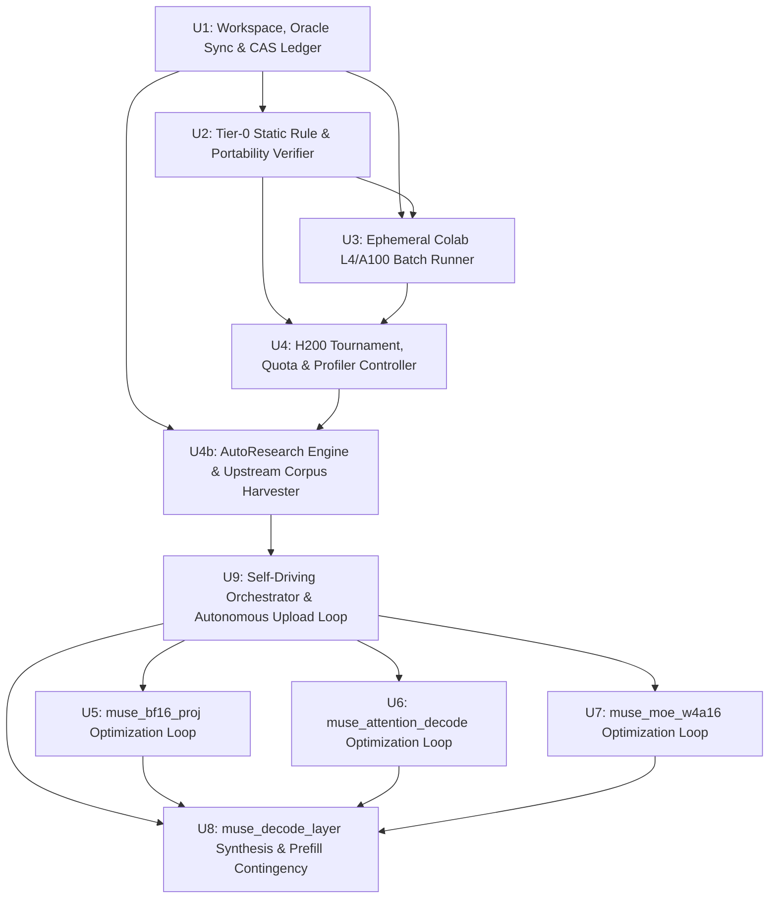
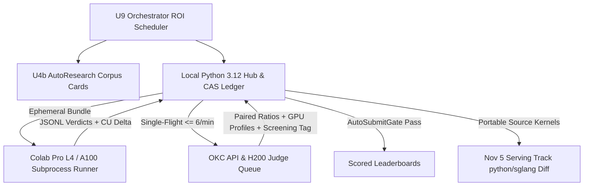

# feat: Build Verifiable Iterative Kernel Optimization Loop for Muse Spark Open

---

## POST-MORTEM & CORRECTED ARCHITECTURE (OCT 30 UPDATE — READ FIRST)

> This section supersedes the naive "generate candidates from scratch and rank them on Colab"
> architecture described in the original U1–U9 body below. Where the two disagree, **this
> section wins**. It records two measured mistakes, both of which cost real quota, and the
> architecture that replaces them.

### M1. The Starter / Baseline Invariant (the mistake that invalidated 15 seeds)

`submission.py` (the *starter*) and `baseline.py` (the *judge's reference*) are **different
programs separated by roughly one order of magnitude**. Treating the starter as the thing to
beat is the single most expensive error this project has made.

| | `submission.py` (starter) | `baseline.py` (what is actually timed) |
| --- | --- | --- |
| `muse_moe_w4a16` | plain PyTorch: expands every NVFP4 expert weight to BF16 **on every call** (3.2 GB of traffic), and runs all 32 experts on all `M` tokens | `moe_wna16_marlin_gemm` — W4A16 straight out of the **packed** NVFP4 bytes, only on compacted `(token, expert)` tiles, with `moe_align_block_size` in front |
| `muse_attention_decode` | plain-torch per-request Python loop over the whole page-table span (up to 80K positions), 97% of which it masks to zero | `flash_attn_with_kvcache` (**FA3**), paged FP8 GQA, reading only the 2,048 positions the window allows |
| `muse_decode_layer` | the same plain-torch expert expansion, 64 times per call | Marlin W4A16 + FA3 + cuBLAS dispatch |
| `muse_bf16_proj` | plain `x @ w.T` | `bf16_gemm_dispatch` (cuBLAS/cublasLt with automatic Split-K tactic selection) |

**Measured proof.** `muse_moe_w4a16/cached_weights` (`77ae4dc6`, job `53a7feb6b818458c`) was
**26x faster than the starter on L4** and scored **0.0927x** on H200 — 10.8x *slower* than the
baseline. Same bytes, opposite verdicts. The L4 comparison was internally consistent and
completely irrelevant.

**Therefore, a hard invariant:**

> A candidate that beats the *starter* is worthless. Only a candidate that matches or beats the
> *baseline's own algorithm class* can score above `1.0x`.

**Direct consequence for U5–U8.** Every optimization on `muse_moe_w4a16`,
`muse_attention_decode`, and `muse_decode_layer` **must fork `baseline.py` directly**, keep its
hand-tuned C++/CUDA kernels intact (`moe_wna16_marlin_gemm`, `flash_attn_with_kvcache`,
`bf16_gemm_dispatch`), and **surgically replace only the measured wrapper, alignment,
pre-attention, and epilogue bottlenecks around them.** Writing a replacement for Marlin or FA3
from scratch is explicitly out of scope: it is a multi-week kernel-engineering problem, and this
project has five days.

### M2. Colab L4 Is a Correctness Gate, Never a Speed Ranker

The Colab L4 VM (`sm_89`) has `torch` and `triton` but **not `sglang`, `sgl_kernel`, `flashinfer`,
or `deep_gemm`**. It therefore cannot import, let alone time, `baseline.py`. Every "Nx faster"
number L4 has produced is a ratio against the *starter* or against another candidate — never
against the baseline.

**Tier 1 is demoted to a one-shot compile/correctness gate.** Its whole job is to answer three
yes/no questions about a standalone custom kernel before it is allowed to cost H200 quota:

1. Does it build? — `nvcc -arch=sm_90a -Xptxas=-v` with **0 register spills** and no local-memory
   traffic, for any `load_inline` CUDA C++ the candidate adds.
2. Is it numerically right? — tolerances pass against `reference.py` on the scored shapes **and**
   the nearby shapes (`m in {3, 5, 7, 9, 33, 130}`, `page_size=64`, `kv_scale=1/64`, `dp` heads,
   skewed/outlier routings).
3. Is it graph-safe? — the 2-step in-place CUDA-graph mutation replay reproduces eager output.

**All performance ranking happens exclusively via remote H200 `okc check`.** There is no cheaper
oracle. Budget accordingly: 20 checks/problem/day is the only real information channel, so a
check must be spent on a candidate whose *algorithm* is already believed to beat the baseline, not
on a hope that L4's relative ordering transfers.

### M3. Blind LLM Triton Sweeps Are Retired

Measured over four generated `muse_moe_w4a16` candidates (Oct 30):

- 4/4 failed their first Tier-1 run on a Triton API error (`atomic_add(other=...)`,
  `tl.store` with a block value on a scalar pointer, `fp8` cast of an `int32` block).
- After feeding the **full** traceback back, 3/4 were repaired to compile and run correctly.
- The two that ran were **40x slower than the plain-torch control**: `BM=16` tiles with one live
  row (wasting 15/16 of every `tl.dot`), NVFP4 nibble decode per output element instead of per
  weight element, and one program per token in the epilogue.

The generator produced the **right algorithm** (packed NVFP4, routed-pair tiles) and the **wrong
implementation quality**. Prompting cannot close that gap.

**Banned:**

- Multi-seed naive Triton generator sweeps as a primary strategy.
- Any `claude-haiku-5.5` call: it exhausts its entire output budget reasoning on the 16 KB Marlin
  prompt and returns empty content **at 8192 and at 16000 tokens**, deterministically. Use
  `gpt-6-luna`, which answers the same prompt.
- Generating a replacement for a hand-tuned kernel (`moe_wna16_marlin_gemm`,
  `flash_attn_with_kvcache`). The generator may only write *new* kernels for the narrow,
  measured gaps named in U5–U8, and each is a hand-specified design, not a direction string.

**Kept (U1–U4 infrastructure is complete and working):**

- `colab_runner.summary()` returns the **full, non-truncated traceback**. The previous 400-char
  cut always severed the frame that named the error, which made every repair round blind.
- `freeze_seeds()` records the Tier-0 verdict in the ledger, so a frozen candidate is dispatchable
  without the orchestrator having run first.
- Capable model routing: a fallback chain over `PREFERRED_MODELS`, so one model's exhausted budget
  cannot kill a batch.
- Tier-0 static verifier, CAS ledger, single-flight rate limiter, quota governor, profiler parser,
  AutoResearch corpus (`artifacts/corpus/sglang_a55ab7d5/`, 1224 files), and `auto_submit`'s
  six-predicate gate.

### M4. The Baseline Profile Overturns the "Wrapper Only" Ceiling (measured Oct 30)

> **This section is the most important one in the document, and it was written after the four
> H200 baseline profiles came back. It contradicts U6, U7 and part of the Corrected Priority
> Order below. Where it disagrees with them, this section wins.**

The corrected architecture said: fork `baseline.py`, keep Marlin/FA3 intact, and win inside the
wrapper around them. Then the profiles measured what that leaves. The answer is that **the
wrapper is too small to reach any board target on its own**, and the plan must say so rather
than chase a number that cannot be hit.

Four baseline checks, all at ~`1.00x`, which is what makes them trustworthy as ground truth:

| problem | job | score_us | the protected hand-tuned family | its share of weighted GPU time |
| --- | --- | --- | --- | --- |
| `muse_bf16_proj` | `0281313b02ef46c2` | 4802.2 | cuBLAS (`nvjet_*` + `splitKreduce`) | 96.7% |
| `muse_attention_decode` | `ab027adac2af428b` | 3769.5 | FA3 mainloop + `FlashAttnFwdCombine` | **82.5%** |
| `muse_moe_w4a16` | `325dde16b92848d8` | 13442.7 | `marlin_moe::Marlin` | **87.5%** |
| `muse_decode_layer` | `8b0625fff6fe49ad` | 22601.6 | `marlin_moe::Marlin` | 49.9% |

**The wrapper-only ceiling, computed from those shares:**

| problem | keep the kernel, replace *all* the wrapper perfectly | board `#50` | verdict |
| --- | --- | --- | --- |
| `muse_attention_decode` | **1.348x** | 2.677x | **unreachable by wrapper work** |
| `muse_moe_w4a16` | **1.253x** | 2.420x | **unreachable by wrapper work** |
| `muse_decode_layer` | 2.650x | 2.225x | reachable, but needs **89%** of the wrapper gone |
| `muse_bf16_proj` | 2.043x | 1.564x | reachable — the baseline *is* the wrapper |

So the "keep Marlin, keep FA3, fix only the wrapper" plan is not a plan for a top-50 finish on
either component; it is a plan for `1.25x` and `1.35x`. U7's own list of fixes (workspace
pre-allocation, the `_MIN_TOKENS_FOR_FUSED = 32` cliff, `local_count=32` alignment) is worth
`1.05-1.11x` even if all three land perfectly and the rest of the wrapper vanishes.

**What is actually true, and what replaces the assumption:**

1. **`muse_bf16_proj` is the only problem where the "surgical wrapper" framing is correct**, and
   it is correct for a specific reason: there the baseline *is* a dispatcher (`96.7%` cuBLAS),
   and cuBLAS is `1.5x-15x` off the pure-bandwidth floor at small `m` because it is a
   general-purpose library. A hand-written Split-K GEMV takes that headroom directly. U5 stands
   as written and is the highest-confidence unit in the plan.
2. **`muse_attention_decode` needs the attention kernel to get faster, not just its wrapper.**
   FA3 is `3.0x-3.5x` off the floor on the big loads and `11x-12x` off on the `decode 1`/
   `verify 1` loads, where a `2048`-position window over 2 KV heads is a *bandwidth* problem that
   a 128-CTA grid of general FMHA tiles serves badly. The wrapper (17.5%) cannot pay for that.
   The reachable route is a **specialised small-load paged FP8 GQA** that keeps FA3 for the big
   full-attention loads: with such a kernel at `1.0x` of floor, the 6-load geomean is `2.38x`;
   at `1.5x` of floor it is `2.24x`; at `2.0x` it is `2.12x`. **All three clear `#50`.** That is
   the real U6, and it is a kernel to write, not a wrapper to fuse.
3. **`muse_moe_w4a16` cannot reach `#50` by wrapper work at all.** Its target requires Marlin
   itself to be ~`40%` faster, or a better expert GEMM. Given the measured `40x` failure of a
   generated replacement and the `0.0927x` failure of weight expansion, the honest conclusion is
   that this problem is **lowest priority and probably a `1.2x` outcome**, and it should be
   worked last with exactly the wrapper fixes U7 names, with no expectation of clearing the
   board.
4. **`muse_decode_layer` is where component wins actually become rank**, and its own baseline
   already shows why: Marlin is only `49.9%` there and cuBLAS another `21.3%`, so the layer has
   more improvable surface (`2.650x` ceiling) than either component. The `#50` target needs `89%`
   of the non-Marlin time removed, which is a real but demanding target, and the U5 dense-GEMM
   work feeds it directly.

**The corrected priority order is therefore:**

| order | problem | honest realistic outcome | why here |
| --- | --- | --- | --- |
| 1 | `muse_bf16_proj` | `1.43x-1.60x` (`#50` at 1.564x) | baseline is cuBLAS; a hand Split-K GEMV at `1.2x` of floor gives `1.433x` and at `1.0x` gives `1.598x`. **The one problem whose target is a kernel, not a wrapper.** |
| 2 | `muse_decode_layer` | `1.4x-1.9x` | 50% improvable surface; consumes U5 directly; the board's rank comes from here |
| 3 | `muse_attention_decode` | `2.1x-2.4x` (`#50` at 2.677x) | needs a specialised small-load paged FP8 GQA; FA3 stays for the big full loads |
| 4 | `muse_moe_w4a16` | `1.05x-1.15x` | wrapper only; the target is out of reach without replacing Marlin, which two measured attempts say not to try |

**What this changes in practice:** no check is spent on a wrapper-only candidate for
`muse_attention_decode` or `muse_moe_w4a16`, because its ceiling is known in advance and it is
below `1.15x` for the MoE at any realistic effort. Checks go to `muse_bf16_proj` (U5) and
`muse_decode_layer` (U8) first, where a number above `1.15x` is actually available.

### Corrected Priority Order (superseded by M4 above — kept for the reasoning)

`muse_bf16_proj` is first because it is the one problem where the baseline is a *dispatch*
(cuBLAS) rather than a hand-tuned kernel. The table in M4 is the authoritative one.

---

## Summary

Build a self-driving local-hub kernel optimization system—combining an automated upstream/GitHub/arXiv research harvester, an ephemeral Colab L4 batch verification runner, a quota-governed H200 tournament controller, and a policy-gated autonomous submission engine—that transitions immediately upon build completion into unattended iterative optimization across the four scored Muse Spark Open decode-step problems (`muse_bf16_proj`, `muse_attention_decode`, `muse_moe_w4a16`, and `muse_decode_layer`) until live Top-35/Top-50 Overall Kernel Leaderboard standing is achieved before November 4.

---

## Problem Frame

The Muse Spark Open Kernel Challenge closes on November 4, 2026 at 11:59 pm PT. Finishing in the Top 50 on the Overall Kernel Leaderboard grants priority queue access on 8xH200 nodes for the $100,000 Serving Track (November 5–19, 2026). The available resources—unlimited LLM code-generation tokens, ~320 Colab Pro Compute Units expiring on November 4, a local CPU-only Linux workstation with `uv` and `google-colab-cli` (`colab` v0.7.5) pre-installed, and 20 unscored check runs plus 10 scored submissions per problem per day on the organizers' bare-metal H200 SXM GPUs—favor high-throughput automated iteration, provided scarce H200 quotas and Colab Compute Units are never wasted on broken, non-compliant, or overfitting candidates.

Direct inspection of the official Open Kernel Challenge `/api/v1` specifications and SGLang's pinned baseline (`a55ab7d5ae1bba59ac351e55026fe7f7644ecc5f`) exposed critical facts that shape both the verification harness and the kernel roadmap:

1. **True Scoring Mechanics and Live Cutoffs (Oct 30, 2026)**: Within each problem, benchmark shapes are grouped into six loads (`decode 1`, `decode 16`, `decode 32` at `L=1`, and `verify 1`, `verify 16`, `verify 32` at `L=8`). Latency within each load is a layer-weighted arithmetic sum (`62` dense projections, `46` sliding-window + `16` full-attention layers, `60` MoE layers), and problem speedup is the geometric mean across the six equal-weight loads. On the Overall Kernel Leaderboard (1,640 ranked teams; 0 job queue backlog across 112 H200 GPUs), rankings reflect effective 62-layer decode-step latency—taking the faster of a team's fused `muse_decode_layer` run or its three component runs (`muse_bf16_proj` + `muse_attention_decode` + `muse_moe_w4a16` plus stock glue). Every current Top-50 team achieves its rank via `muse_decode_layer`, where the #50 cutoff stands at `2.2045x` (`10,261.0 us` vs. SGLang's `22,620.3 us`) and #25 stands at `2.2520x` (`10,044.5 us`). Component Top-50 benchmarks stand at `1.5617x` (`muse_bf16_proj`), `2.6553x` (`muse_attention_decode`), and `2.4030x` (`muse_moe_w4a16`).
2. **Concrete H200 (`sm_90a`) Baseline Defects in Stock SGLang**:
   - *Blackwell-only dead ends*: SGLang's experimental Helion megakernels, LayerNorm-SP, and MegaMoE paths are hard-gated to `sm_100`/`sm_103` (Blackwell W4A4, TP4) and cannot execute on H200 TP8/EP8 W4A16.
   - *MoE `< 32` token cliff and EP8 padding waste*: `fused_post_expert_norm_weighted_sum_triton.py` sets a 32-token minimum threshold, falling back to 9+ unfused eager PyTorch FP32 kernels on three of the six scored loads (`M in {1, 8, 16}`). In addition, `moe_align_block_size` sorts across 256 global IDs instead of 32 local IDs, `marlin_make_workspace` reallocates dynamically, and intermediate buffers (`[M*8, 8192]` and `[M*8, 4096]`) materialize 7/8ths dead non-local routes under EP8.
   - *Unfused 5-launch pre-attention path*: `MuseSpark1xAttention` disables fused FP8 KV-cache writes on FA3, causing five separate pre-attention launches (`FusedQKNorm` with duplicate RoPE loads, two FP8 KV casts, `store_cache`, and an FP8 query cast), while FA3 `scheduler_metadata` is omitted (`None`) on all 46 sliding-window layers and all `L=8` verify loads.
   - *Router and small-M dense GEMM gaps*: SGLang's split-K `router_gemm.cuh` is unwired in `baseline.py` (`m <= 8` falls back to FP32 `F.linear`, while `m > 8` launches two separate BF16 GEMMs for `hi` and `lo`), and `_bf16_gemm_dispatch_impl` uses stock cuBLAS without Hopper small-`M` Split-K/GEMV tuning.
3. **Cross-Architecture Verification Constraints**: The local workstation has no GPU, and its default active Python is 3.14 (requiring an explicit Python 3.12 pin to match container AST semantics). On Colab Pro, T4 (`sm_75`) lacks hardware BF16 and FP8 Tensor Cores, and A100 (`sm_80`) lacks hardware FP8 (`float8_e4m3fn`) Tensor Cores; therefore **Colab L4 (`sm_89`)** is the primary low-cost (~1.7 CU/hr) functional and CUDA-graph verifier for BF16+FP8, paired with offline `nvcc`/`ptxas` cross-compilation to `sm_90a` for Hopper-exclusive kernels.

| Execution Tier | Hardware / Target | Primary Role in Verifiable Loop | Cost / Quota Ceiling |
|---|---|---|---|
| **Tier 0: Static & Contract Gate** | Local Linux CPU (Python 3.12) | AST rule compliance, CUDA-graph ban checks, precision/anti-cheat lint, Serving Track portability check | 0 CU / Unlimited |
| **Tier 1: Compile & Correctness Gate** (not a speed ranker — see M2) | Ephemeral Colab L4 (`sm_89`, 24 GB VRAM, 12.7 GB Host RAM) | **Yes/no only:** `nvcc -arch=sm_90a -Xptxas=-v` builds with 0 spills; `reference.py` tolerances pass on scored + nearby shapes; the 2-step in-place mutation CUDA-graph replay reproduces eager. The VM has no `sglang`/`sgl_kernel`/`flashinfer`/`deep_gemm`, so it **cannot time `baseline.py`** and its ratios are not a speed signal | ~1.7 CU/hr (~320 CU pool) |
| **Tier 2: High-Host-RAM / Prefill Gate** | Ephemeral Colab A100 `--high-mem` (`sm_80`, 40/80 GB VRAM, >50 GB Host RAM) | On-demand escalation strictly for heavy single-TU CUTLASS/CuTe C++ builds exceeding L4's 12.7 GB host RAM or deferred `muse_prefill_layer` `16K` full-attention verification (~25 GiB VRAM) | ~6.5–10 CU/hr (strictly capped) |
| **Tier 3: Ground-Truth H200 Judge** | Remote OKC H200 SXM (`sm_90a`, 141 GB, CUDA 13.0 / PyTorch 2.14) | Interleaved cold-L2 paired-ratio timing vs. SGLang baseline, GPU kernel profiler breakdown, **the only speed oracle and the only basis for Pareto promotion** | 20 checks + 10 submits / problem / UTC day |

---

## Requirements

- **R1. Immutable Multi-Tier Verification Funnel**: Every candidate `submission.py` must be stored in a content-addressed artifact store (`sha256`) and pass Tier-0 static compliance and Tier-1/2 Colab GPU functional + CUDA-graph verification on that exact hash before consuming any remote H200 `okc check` quota.
- **R2. Strict OKC Rule and Anti-Cheat Compliance**: All generated and promoted kernels must preserve the `# okc: problem=<name>` header, execute cleanly inside `torch.cuda.CUDAGraph` with zero host synchronization or value-dependent control flow, keep `prepare()` well under the 300-second limit (enforced at `<= 180s` on Colab), respect weight/activation precision rules (including 1-in-8 sparse power-of-two probe rows at `1e-3`, in-place FP8 KV cache writes at `8%`, router top-8 margin/floor checks, and residual delta checks), and attend across all valid keys without sparse or top-k skipping.
- **R3. Nearby-Shape Generalization**: Tier-1 Colab verification must evaluate non-scored nearby shapes (`m`/`batch` values such as `3, 5, 7, 9, 33, 130`, `page_size=64`, `kv_scale=1/64`, outlier and skewed routing distributions) alongside scored shapes so promoted kernels survive post-deadline held-out reruns without shape-hardcoding regressions.
- **R4. Ephemeral Compute-Unit and Daily UTC Quota Governance**: Colab batches must run via ephemeral VM lifecycles (defaulting to L4, auto-releasing VMs in unconditional cleanup, logging pre/post CU balances with circuit breakers), and remote H200 calls must obey a single-flight rate-limited queue (`<= 6 req/min/token`) with UTC-day quota buckets (Calibration, Exploration, Protected Reserve) across the 80 daily check slots across the four scored problems.
- **R5. Autonomous Policy-Gated Submissions & One-Time Login**: Initial `okc login` / rules acceptance (`2026-10-22.1`) and destructive `okc withdraw` actions remain human-confirmed. `okc check` runs execute **100% autonomously** under the rate limit and UTC check quota, and scored `okc submit` uploads execute autonomously through a mathematical `AutoSubmitGate` whenever a CAS-verified candidate passes Tier-0, Tier-1 Colab L4 (including nearby shapes), and Tier-3 H200 `okc check`, clears `>= 1.15x` for a problem's first upload or beats the current best submitted geomean by `>= 1.5%` thereafter (progressive milestones), shows 95% CI separation, exhibits `< 5%` max single-load regression, and respects time-of-day UTC submit quota reserves.
- **R6. Serving Track Source-Diff Portability**: Kernel designs must avoid rebuilding prebuilt `sgl-kernel` binaries or touching `model_loader/`, keeping custom kernels self-contained in Python, Triton, CuTe DSL, TileLang, or inline C++/CUDA (`load_inline`) with line lengths and source sizes compatible with the November 5 Serving Track (`python/sglang/` unified diff `<= 720 KB`, lines `<= 400` chars, zero forbidden judge identifiers).
- **R7. `muse_bf16_proj` Optimization Target**: Achieve a verified H200 geometric-mean speedup `>= 1.56x` (`<= 3,090 us` vs. `4,830.8 us` baseline, live `#50` `1.5642x`) across all 30 benchmark cases (6 loads x 5 layers). This is the one target M4 leaves exactly as written, because here the baseline *is* a cuBLAS dispatch (`96.7%`) and a hand Split-K GEMV takes that headroom directly.
- **R8. `muse_attention_decode` Optimization Target (revised by M4)**: The board's `#50` line is `>= 2.66x` (`<= 1,415 us`). FA3 is **82.5%** of this problem, so a fork that keeps it caps at **`1.348x`**; a specialised small-load paged FP8 GQA that keeps FA3 only for the big full-attention shapes is worth `2.1x-2.4x`, and that is the working requirement. All 12 benchmark cases must pass (`weight=46` sliding + `weight=16` full across 6 loads) including valid in-place `k_cache`/`v_cache` updates.
- **R9. `muse_moe_w4a16` Optimization Target (revised by M4)**: The board's `#50` line is `>= 2.40x` (`<= 5,595 us`), but the measured profile puts `marlin_moe::Marlin` at **87.5%** of this problem, so a fork that keeps Marlin caps at **`1.253x`** even with a free wrapper. The requirement is therefore instrumented as: best measured H200 geomean with Marlin intact, expected `1.05x-1.15x`, recorded rather than chased. The `2.40x` figure stays here as the board's number, not the work's promise.
- **R10. `muse_decode_layer` Overall Target (revised by M4)**: Synthesize component winners and cross-boundary fusions into `muse_decode_layer`. The measured profile (`8b0625fff6fe49ad`) gives it the most improvable surface of the four — 40% non-Marlin, 21.3% of it cuBLAS that U5 attacks directly — so the working requirement is `1.4x-1.9x`, with the board's `>= 2.225x` (`<= 10,165 us`) tracked as the stretch that needs 89% of that 40% removed. `muse_prefill_layer` adaptation unlocks only once a live leaderboard poll shows Overall rank `<= 35` with at least a `4%` latency cushion below the live `#50` cutoff.
- **R11. Closed-Loop AutoResearch & Code Corpus Harvesting**: Before optimizing each problem and whenever 2 consecutive H200 check iterations plateau (`< 1.5%` geomean gain), the loop must automatically harvest exact upstream reference code from pinned SGLang (`a55ab7d5ae1bba59ac351e55026fe7f7644ecc5f`), search GitHub repositories (`sglang`, `flashinfer`, `vllm`, `marlin`, `DeepGEMM`, `cutlass`, `tilelang`, `gpu-mode`) via authenticated GitHub code/PR search, and query web/arXiv literature to produce structured `research_cards` consumed directly by the candidate generator.
- **R12. Self-Driving Execution Loop Upon Build Completion**: Completing the harness (`U1`–`U4b`) must immediately transition into running the autonomous execution loop (`U9`) across `U5` -> `U6` -> `U7` -> `U8`, iterating live candidate generation, Colab L4 batch verification, H200 `okc check` profiling, Pareto synthesis, and autonomous `okc submit` uploads without human intervention until live Top-35/Top-50 targets are achieved.

---

## Scope Boundaries

- **No autonomous `okc login`, rules acceptance, or `okc withdraw`**: One-time initial `okc login` / rules acceptance (`2026-10-22.1`) and destructive `okc withdraw` actions remain strictly human-confirmed, whereas `okc check` and `AutoSubmitGate`-qualified `okc submit` runs execute unattended (`R5`, `R12`).
- **No Serving Track SGLang repo patching before November 5**: While kernels are engineered for `python/sglang/` drop-in portability (R6), `okc serve init` and 8xH200 full-node serving patches are excluded until the Serving Track opens on November 5 at noon PT.
- **No `sm_100`/`sm_103` Blackwell W4A4 or Helion TP4 ports**: Effort targets H200 (`sm_90a`) TP8/EP8 W4A16 and FP8 FA3 exclusively.
- **No approximate/sparse attention or lossy weight re-quantization**: Strictly excluded per official disqualification rules and anti-cheat probes.

### Deferred to Follow-Up Work

- **`muse_prefill_layer` large-`T` (`753, 3012, 16384`) tuning**: Deferred until `muse_decode_layer` is uploaded and a live poll confirms Overall rank `<= 35` with a `>= 4%` latency cushion below the live `#50` cutoff, because `muse_prefill_layer` is excluded from the Overall Kernel Leaderboard and shares identical file/function contracts with `muse_decode_layer`.
- **Serving Track (`okc serve`) multi-GPU TP8/EP8 integration**: Deferred to a separate November 5 plan once Top-50 priority queue status is locked (transferring winning fused ops, TP8 pooler/unpooler `gemm_ag` sharding, and DFlash2 drafter optimizations into `python/sglang/`).

---

## Context & Research

### Relevant Code and Patterns

- **Greenfield local repository**: The workspace currently contains zero files. Local tooling discovery confirmed `uv 0.13.5`, pre-installed Python `3.12.15`, `git 2.53.0`, an authenticated `gh 2.46.0` (enabling `gh search code` / `gh search prs` for `U4b` research), Python stdlib `sqlite3`, and pre-installed `google-colab-cli 0.7.5` (`colab` CLI, supporting ephemeral `run` across `L4`/`A100`/`H100`/`T4` and `usage` balance queries).
- **Official OKC problem layout (`okc init <problem>` / `GET /api/v1/problems/{problem}`)**: Each problem directory contains `submission.py` (prefixed with `# okc: problem=<name>`), `baseline.py` (pinned SGLang `a55ab7d5` implementation), `reference.py` (`generate_weights`, `generate_input`, `ref_kernel`, `check_implementation`, `speed_of_light_ns`, plus `collect` and `check_routing` where applicable), `checks.py` (whole-tensor relative L2 plus `5.0x` worst-row L2 with `0.1` mean-row norm floor), `nvfp4.py` (on MoE/layer problems: E2M1 nibbles + `float8_e4m3fn` 16-element group scale + `float32` global scale), `TASK.md`, and `AGENTS.md`.
- **SGLang `a55ab7d5` baseline modules available inside `lmsysorg/sglang:dev-muse-spark-open`**:
  - `sglang.srt.layers.quantization.unquant._bf16_gemm_dispatch_impl` and unwired `sglang.kernels.ops.muse_spark_v12.router_gemm`
  - `sgl_kernel.flash_attn.flash_attn_with_kvcache` (FA3), `sglang.kernels.ops.muse_spark_v12.fused_qk_norm.FusedQKNorm`, `sglang.kernels.ops.muse_spark_v12.norm_gate.rms_norm_gate`, `sglang.kernels.ops.muse_spark_v12.fused_norm_gate.FusedRMSNormGate`
  - `sglang.srt.layers.quantization.marlin_utils_fp4.prepare_moe_nvfp4_layer_for_marlin`, `sglang.kernels.ops.moe.moe_wna16_marlin.moe_wna16_marlin_gemm`, `sglang.kernels.ops.muse_spark_v12.fused_post_expert_norm_weighted_sum_triton`
  - `sglang.kernels.ops.muse_spark_v12.fused_norm_residual.FusedPostNormResidualPreNorm` and `sglang.kernels.ops.muse_spark_v12.fused_muse_spark_routing.FusedMuseSparkRouting`
  - Pre-installed kernel toolkits in the H200 judge container: PyTorch, Triton, FlashInfer, DeepGEMM, TileLang, CuTe DSL, CUTLASS, and `torch.utils.cpp_extension.load_inline` (`nvcc`).

### Institutional Learnings

- No prior `docs/solutions/` directory exists in this greenfield workspace. Institutional guardrails from official `AGENTS.md` and `TASK.md` are codified directly into Tier-0 and Tier-1 gates: always benchmark and verify inside captured CUDA graphs rather than eager execution, account for cold-L2 flushes before every replay and ~4 us graph-replay subtraction, and never rely on single-seed or scored-shape-only tuning.

### External References

- Open Kernel Challenge LLM & API Specification: `https://openkernelchallenge.dev/llms.txt` and `https://openkernelchallenge.dev/api/v1/problems`
- Open Kernel Challenge Rules & Serving Spec: `https://openkernelchallenge.dev/rules` and `https://openkernelchallenge.dev/api/v1/serving`
- Pinned SGLang Muse Spark Open Source (`commit a55ab7d5ae1bba59ac351e55026fe7f7644ecc5f`): `https://github.com/sgl-project/sglang`

---

## Key Technical Decisions

| Decision | Chosen Approach | Rationale & Trade-off |
|---|---|---|
| **Local Python Version Pin** | Pin workspace `uv` environment to Python `3.12` | System default Python is `3.14.9`; pinning `3.12` prevents PEP 750/758 syntax drift and ensures local AST checks and CPU tests match the H200 judge container (`lmsysorg/sglang:dev-muse-spark-open`). |
| **Colab Primary GPU Tier** | Default **100% of decode tests & benchmarks** to ephemeral **Colab L4 (`sm_89`)** with strict 12.7 GB host-RAM hygiene; reserve A100 `--high-mem` (`sm_80`) strictly for heavy CUTLASS host-RAM builds or deferred `16K` prefill; ban T4 (`sm_75`) for BF16/FP8 | Exact tensor sizing proves all four scored decode problems (even `ctx=80K`, `300K`, and `1M` under TP8's 256-byte/token FP8 KV cache and `6.75 GiB` 256-expert NVFP4 weights) fit inside `< 9.5 GiB` GPU VRAM on L4, whereas L4's host RAM requires a zero-`torch` parent supervisor and memory-bounded `load_inline` compilation. Keeping decode checks on L4 preserves native `sm_89` FP8 hardware validation at ~1.7 CU/hr. |
| **Hopper (`sm_90a`) & Container Package Split** | Dual-capability manifest (`portable_sm89` vs. `hopper_sm90a_specialized`) with offline `sm_90a` PTX/cubin compile + L4 attention fallback shim for judge-only packages | The H200 judge container (`CUDA 13.0.3`, `torch 2.14.1`) bundles `sglang`, `sgl_kernel` (FA3), `flashinfer`, `nvidia-cutlass-dsl`, `sgl-deep-gemm`, and `tilelang`, which are absent on stock Colab VMs, while `reference.py`, `checks.py`, and `nvfp4.py` are pure PyTorch. Offline `sm_90a` compile + a lightweight L4 attention shim lets Colab verify surrounding fused pre-attention, sliding-window, router, and MoE kernels plus CUDA-graph safety before spending an H200 `okc check`. |
| **Latency Truth vs. Colab Timing** | Use Colab strictly for correctness, CUDA-graph mutation-replay, and analytical byte/register metrics; use H200 `okc check` for latency selection | L4's 48 MB L2 cache + 300 GB/s GDDR6 (16x slower than H200's 4.8 TB/s HBM3e) distorts compute-vs-bandwidth crossover thresholds (`M` dispatch cutoffs). Only H200 cold-L2 paired-ratio medians govern dispatch boundaries and tournament promotion. |
| **Component-First With Continuous Whole-Layer Integration** | Optimize `muse_bf16_proj`, `muse_attention_decode`, and `muse_moe_w4a16` as isolable units, but stand up a baseline-wired `muse_decode_layer` candidate on Day 1–2 and integrate component wins into daily whole-layer `okc check` runs across Days 2–5 | Multiplies effective H200 daily check capacity to 80/day across the 4 problems and isolates per-stage profiler bottlenecks, while harvesting `muse_decode_layer`'s non-transferable 20/day quota from Day 1 instead of leaving ~57 slots unused. Continuous integration also measures cross-boundary fusion gains against the actual Overall-board metric, since standalone component sums plus stock glue cannot beat the `#50` Overall cutoff without fusion. |
| **Closed-Loop AutoResearch on Plateau** | Trigger corpus/GitHub/arXiv research before a problem starts and after 2 consecutive `< 1.5%` H200 geomean gains; store distilled `research_cards` with provenance in `ledger.sqlite3` | Pure mutation without new information plateaus quickly on the hardest kernels (W4A16 EP8 compaction, FP8 SWA attention). Research cards rotate the search toward genuinely different kernel families (e.g., Marlin wrapper -> persistent `lop3` W4A16) and keep every candidate's inspiration traceable, which also protects against accidental re-trying of dead ends. |
| **Autonomous Policy-Gated Submit** | Run `okc check` autonomously under quota and rate limits; gate only scored `okc submit` through a mathematical `AutoSubmitGate`; keep `okc login`, `/rules/accept`, and `okc withdraw` human-gated | The 10 scored submits/problem/day reset at 00:00 UTC, so a human-in-the-loop card serializes the loop to human availability and wastes most scored slots. Gate predicates (1.5% geomean gain, non-overlapping 95% CI, `< 5%` max single-load regression, H200 nearby-shape pass, UTC reserve) make unattended uploads statistically safe rather than reckless, and keep daily submit quota from being burned on noise. Checks are not gated because requiring a completed check before allowing a check would deadlock. |
| **Pareto Archive & Shape Dispatching** | Track per-load latency vectors across all 6 decode/verify loads and synthesize shape-bucketed composite dispatchers | A kernel winning `M=1` decode often regresses `M=256` verify; keeping Pareto-optimal specialists per `(M, layer)` regime and dispatching on static shape/config inside CUDA graphs maximizes the 6-load geometric mean without violating anti-overfitting rules (provided nearby intermediate shapes route smoothly to adjacent buckets). |

---

## Alternative Approaches Considered

- **Run the entire development loop inside a persistent Colab Pro A100 session**: Rejected because persistent A100 sessions burn ~6.5–13 CU/hr even while LLM agents think or wait on remote H200 jobs (exhausting 320 CU in ~1–2 days), and A100 (`sm_80`) cannot execute native FP8 `e4m3fn` instructions needed by attention and NVFP4 scale paths.
- **Skip Colab verification and test directly via remote H200 `okc check`**: Rejected because 20 checks/problem/day is tight when exploring 10–20 LLM-generated kernel variants per problem; compile failures, subtle CUDA-graph stale-pointer bugs, or 1-in-8 probe-row tolerance misses would exhaust daily H200 quotas within an hour.
- **Optimize `muse_decode_layer` monolithically from Day 1 without component problems**: Rejected as the *only* strategy because debugging numerical or graph-capture failures across 19 weight tensors and 15+ sub-ops wastes 15-minute job timeouts and leaves 60/day component `okc check` slots unused — but partially adopted, since a baseline-wired `muse_decode_layer` now starts consuming its own daily quota from Day 1–2.
- **Human-approved `okc submit` for every upload**: Rejected under R5 because 10 scored submits/problem/day reset at 00:00 UTC; a human-approval card would idle most scored slots during a 5-day sprint. Replaced by the statistical `AutoSubmitGate` (1.5% gain, non-overlapping 95% CIs, `< 5%` per-load regression, nearby-shape pass, UTC reserve), with `okc withdraw` left human-only.
- **Pure mutation search without external research**: Rejected because the hardest kernels (EP8 W4A16 compaction, FP8 sliding-window attention) plateau quickly; `U4b` rotates the search toward new kernel families on a 2-check `< 1.5%` plateau signal while keeping every candidate traceable to a cited source.

---

## Open Questions

### Resolved During Planning

- **How does Overall Kernel Leaderboard aggregation work?**: Resolved via `TASK.md` and empirical live leaderboard analysis—overall rank reflects effective 62-layer decode-step speedup (the better of `muse_decode_layer` or the 3 component problems + stock glue across the 6 decode/verify loads), making `muse_decode_layer` the definitive Top-50 gate in principle — though M4 measures that its `#50` line needs 89% of the layer's non-Marlin time removed, so it is a stretch rather than a schedule.
- **Can SGLang's experimental Helion megakernels or LayerNorm-SP be enabled directly on H200?**: Resolved via SGLang `a55ab7d5` source inspection—both are hard-gated on Blackwell (`sm_100`/`sm_103`, W4A4, TP4) and unusable on H200 (`sm_90a`, TP8/EP8, W4A16).
- **How do local CPU agents execute batch GPU checks on Colab without manual copy-paste?**: Resolved via local discovery of pre-installed `google-colab-cli` (`colab` v0.7.5), which supports ephemeral `colab run` script execution on L4/A100 with automatic VM teardown, backed by a portable `.ipynb`/tarball fallback if browser execution is ever needed.
- **Can scored `okc submit` run unattended without risking quota or integrity?**: Resolved as a policy decision (R5): yes, behind the `AutoSubmitGate`, because the 10 scored submits/problem/day reset daily and a human-approval card would idle most of them. Safety comes from non-overlapping 95% CIs, a `1.5%` minimum gain, a `< 5%` per-load regression cap, a passed nearby-shape suite, and per-problem UTC submit reserves; `okc withdraw` remains human-only.
- **Is there a source of new optimization ideas beyond mutation?**: Resolved via `U4b` AutoResearch, which indexes the pinned SGLang `a55ab7d5` tree plus GitHub kernel repos and arXiv, gated on a 2-check `< 1.5%` plateau so it fires when mutation stops paying.

### Deferred to Implementation

- **Exact `research_card` markdown schema and retrieval ranking weights**: The card fields (bottleneck, hypothesis, source citations with commit/URL, applicable shapes, portability notes, expected mechanism) are settled at `U4b` implementation time and validated against the first three real cards rather than guessed now.
- **Exact `AutoSubmitGate` milestone floors per problem**: First-upload thresholds (no personal best yet) are calibrated from the Day-1 baseline calibration and the first two `okc check` results, since a floor set too high would block all early uploads and one set too low would spend quota on weak candidates.
- **Exact C++ include paths and package build hashes inside `lmsysorg/sglang:dev-muse-spark-open`**: While research established the container base (`CUDA 13.0.3`, `torch 2.14.1`, `sglang-kernel 0.4.9`, `flashinfer_python[cu13] 0.7.0.post1`, `nvidia-cutlass-dsl[cu13] 4.8.0`, `sgl-deep-gemm 0.2.1.post1`, `tilelang 0.1.12`), exact site-packages C++ header directories inside the container for `load_inline` includes are recorded on the first Day-1 Calibration `okc check` log into `artifacts/container_fingerprint.json`.
- **Exact H200 crossover `M` thresholds between Split-K GEMV and WGMMA/cuBLAS/Marlin tiles**: Determined empirically from H200 `okc check` per-load paired-ratio tables rather than Colab L4 timings.
- **Custom W4A16 CuTe/CUDA kernel vs. compacted Marlin + custom epilogue for `muse_moe_w4a16`**: Both tracks are structured as competing candidates in `U7`; H200 cold-L2 profiler numbers across `M in {1, 8, 16, 32, 128, 256}` will decide whether full custom W4A16 GEMV/GEMM beats route-compacted Marlin at `M=128, 256` or pairs with it via shape-bucket dispatch.

---

## Output Structure

```text
AGENTS.md
pyproject.toml
docs/
  plans/
    2026-10-30-001-feat-okc-verifiable-kernel-loop-plan.md
artifacts/
  cas/                          # Content-addressed candidate blobs (<sha256>.py + metadata.json)
  bundles/                      # Self-contained Colab batch verification scripts & fallback notebooks
  corpus/                       # Sparse-indexed SGLang a55ab7d5 ops + structured markdown research_cards/
  ledger.sqlite3                # WAL-mode SQLite ledger (candidates, verifications, quotas, CU, Pareto, research_cards)
  container_fingerprint.json    # Locked H200 judge container package/arch/header versions
problems/                       # Official synced OKC problem workspaces (untouched oracle copies)
  muse_bf16_proj/
  muse_attention_decode/
  muse_moe_w4a16/
  muse_decode_layer/
  muse_prefill_layer/
src/
  okc_loop/
    __init__.py
    cli.py                      # Unified loop entrypoint (sync, sync-corpus, lint, colab-batch, check, pareto, run)
    api_client.py               # Rate-limited (<=6/min) OKC HTTP/CLI wrapper + public API sync
    ledger.py                   # SQLite WAL schema, two-phase quota reservation, Pareto & research provenance archive
    scoring.py                  # Exact 2-level load AM -> 6-load GM + 62-layer overall decode estimator
    verifier_static.py          # Tier-0 Python 3.12 AST CUDA-graph, precision, anti-cheat & serving-diff linter
    colab_runner.py             # Ephemeral Colab L4/A100 batch packager, subprocess runner & CU tracker
    profiler_parser.py          # H200 okc check JSON/profile/log parser & bottleneck extractor
    synthesizer.py              # Shape-bucket composite dispatcher builder across Pareto specialists
    autoresearch.py             # Closed-loop SGLang a55ab7d5, GitHub kernel repo & web/arXiv research card generator
    llm_client.py               # Provider/model boundary: prompt contract, code extraction, retries, token budget
    generator.py                # Research card + profiler bottleneck + failure trace -> candidate source in CAS
    auto_submit.py              # Mathematical AutoSubmitGate (geomean gain, 95% CI, max-load regression, UTC reserve)
    orchestrator.py             # Self-driving ROI scheduler & end-to-end evolutionary execution loop
    candidates/                 # Modular kernel template generators & variant registries per problem
      bf16_proj/
      attention_decode/
      moe_w4a16/
      decode_layer/
tests/
  test_ledger_and_quota.py
  test_scoring.py
  test_verifier_static.py
  test_colab_runner_payload.py
  test_profiler_parser.py
  test_synthesizer.py
  test_autoresearch.py
  test_bf16_proj_candidates.py
  test_attention_candidates.py
  test_moe_candidates.py
  test_decode_layer_candidates.py
  test_orchestrator_and_autosubmit.py
```

---

## High-Level Technical Design

> *This illustrates the intended approach and is directional guidance for review, not implementation specification. The implementing agent should treat it as context, not code to reproduce.*



**Candidate Promotion & Autonomous Upload Invariant (Directional Pseudo-Grammar):**

```text
if problem_uninitialized or last_two_h200_checks_gain(problem) < 0.015:
  research_card := autoresearch_bottleneck(problem, latest_h200_profile) -> artifacts/corpus/research_cards/

candidate_blob := freeze_single_file(problem, source_text, research_card_id) -> sha256

assert tier0_static_check_with_local_repair(candidate_blob, max_repairs=3):
  - line_1 == "# okc: problem=" + problem
  - python312_ast_valid
  - zero_forbidden_calls_in_hot_path(.item, .cpu, .numpy, synchronize, nonzero, subprocess, socket, reference)
  - zero_forbidden_serving_tokens_and_within_720kb_400col_budget
  - all_triton_or_jit_specializations_bound_or_warmed_in_prepare

assert tier1_colab_subprocess_check(candidate_blob, gpu="L4" | "A100"):
  - prepare_wall_time_s <= 180.0
  - if hopper_sm90a_specialized: nvcc_ptxas_sm90a_compile(spills == 0, dsmem_kb <= 228)
  - multi_graph_interleaved_mutation_replay(shape_A, shape_B, fresh_inputs_1, fresh_inputs_2) == PASS
  - official_reference_checks(scored_shapes + nearby_edge_shapes) == PASS

if pareto_tournament_rank(batch_passes) <= K_promote and utc_check_budget_allows(problem, bucket):
  reserve_wal_slot(sha256, "check") -> single_flight_okc_check(sha256)
  ingest_per_load_ratios_and_gpu_profile(sha256) -> update_pareto_archive(problem)

if autosubmit_gate_passes(
  sha256,
  geomean >= max(best_submitted(problem) * 1.015, milestone_floor(problem)),
  ci95_lower_bound > best_submitted_ci95_upper_bound,
  max_single_load_regression < 0.05,
  nearby_shapes_verified == True,
  utc_submit_reserve_allows(problem, current_utc_hour)
):
  reserve_wal_slot(sha256, "submit") -> autonomous_okc_submit(problem, sha256)
  verify_leaderboard_placement(problem, sha256) -> update_personal_best(problem)
```

---

## Implementation Units



### U1. Workspace Bootstrap, Official Problem Sync, and Immutable CAS Ledger

**Goal:** Initialize the Python 3.12 repository structure, install/wrap the `okc` CLI and public HTTP API syncer to pull verbatim oracle files for all five problems, and establish the content-addressed artifact store (`sha256`) and SQLite WAL experiment ledger.

**Requirements:** R1, R4, R5

**Dependencies:** None

**Files:**
- Create: `pyproject.toml`
- Create: `AGENTS.md`
- Create: `.gitignore`
- Create: `src/okc_loop/__init__.py`
- Create: `src/okc_loop/api_client.py`
- Create: `src/okc_loop/ledger.py`
- Create: `src/okc_loop/scoring.py`
- Create: `src/okc_loop/cli.py`
- Test: `tests/test_ledger_and_quota.py`
- Test: `tests/test_scoring.py`

**Approach:**
- Pin `pyproject.toml` strictly to Python `>=3.12,<3.13` using the local Python 3.12 interpreter so all AST and unit tests run against 3.12 semantics.
- Add a root `.gitignore` excluding `.env*`, `artifacts/`, `problems/`, and any local profile/log output, and read `OKC_TOKEN` / `colab` credentials only from user-scoped config or environment variables outside the repository.
- Wrap the official `okc init <problem> problems/<problem>` command rather than re-implementing file materialization, then lock the resulting `baseline.py`, `reference.py`, `checks.py`, `nvfp4.py`, `TASK.md`, and `AGENTS.md` with SHA-256 digests in a manifest and `chmod 0444`; `api_client.py` fails closed if a locked digest changes on re-sync, and re-verifies oracle digests before packaging Colab batches or dispatching H200 runs.
- Parse the fenced correctness-test block from `TASK.md` and the JSON `benchmarks` payload into a SHA-256-locked `problems/<problem>/cases.json` (assigning deterministic seeds for text-only cases) so Tier-1 has runnable case definitions.
- Use `api_client.py` for leaderboard/queue/account queries with an explicit non-default `User-Agent` header, discarding free-text competitor team names so untrusted strings never reach agent prompts.
- Check authentication readiness (`OKC_TOKEN` or `okc` config plus `/api/v1/me` `rules.accepted_at`) without ever attempting automated rule acceptance; when unauthenticated, surface clear instructions for the human to run interactive login once.
- Implement `src/okc_loop/ledger.py` on Python stdlib `sqlite3` in WAL mode tracking: content-addressed candidate blobs (`artifacts/cas/<sha256>.py`), lineage (parent hashes, hypothesis tag, capability tier, `research_card_id`), per-tier verification verdicts, two-phase dispatch states (`STAGED`, `RESERVING_QUOTA`, `DISPATCHED`, `INGESTED`, `AMBIGUOUS_TIMEOUT`) for both `check` and `submit`, UTC-day quota counters per problem (`check` out of 20, `submit` out of 10), Colab Compute Unit balance snapshots, and per-load H200 timing vectors with 95% confidence intervals.
- Implement `src/okc_loop/scoring.py` encoding the exact two-level OKC problem score (layer-weighted arithmetic sum within each of the 6 loads, followed by equal-weight geometric mean across loads) plus the 62-layer Overall decode-step latency estimator comparing whole-layer `muse_decode_layer` vs. component assembly. `okc check` shape metrics already include the judge's per-replay ~4 us subtraction, so `scoring.py` applies no second subtraction; overhead adjustment happens only when estimating from raw local GPU graph-replay timings.

**Execution note:** Implement `scoring.py` and `ledger.py` test-first against the live leaderboard numbers and SGLang baseline microseconds (`4830.8`, `3766.3`, `13448.5`, `22620.3`, `387403.9`) to guarantee exact numerical parity with the judge.

**Patterns to follow:**
- Official `/api/v1/problems/{problem}` schema and `okc init` first-line `# okc: problem=<name>` convention.

**Test scenarios:**
- **Happy path:** Syncing a problem payload materializes all expected files (`submission.py` with `# okc: problem=<name>` prepended, `baseline.py`, `reference.py`, `checks.py`, `nvfp4.py` when present, `TASK.md`, `AGENTS.md`) and records matching oracle SHA-256 digests.
- **Happy path:** Given per-shape paired ratios and SGLang baseline latencies across 6 loads (`weight=46` sliding + `weight=16` full), `scoring.py` reproduces the exact problem speedup, microsecond value, and 62-layer effective decode-step ranking order observed on live leaderboard teams (both whole-layer-dominant and 3-component-dominant cases).
- **Edge case:** Submitting identical candidate source whitespace/bytes resolves to the existing CAS `sha256` and marks the candidate as deduplicated without reserving a new `okc check` slot.
- **Edge case:** Quota counters roll over cleanly across `23:59:59 UTC -> 00:00:00 UTC` regardless of local machine timezone.
- **Error path:** Simulated network timeout after `DISPATCHED` transitions the ledger row to `AMBIGUOUS_TIMEOUT` and blocks automatic re-dispatch of that job until reconciled via `/api/v1/jobs`.
- **Error path:** Attempting any authenticated check/submit call when `/api/v1/me` reports `rules.accepted_at == null` halts immediately with a human login prompt rather than calling `/rules/accept`.

**Verification:**
- All five official problems sync cleanly into `problems/` with verified SHA-256 oracle locks, and unit tests for CAS hashing, WAL state transitions, UTC quota rollover, and two-level scoring pass under Python 3.12.

---

### U2. Tier-0 Local Static Verifier, Anti-Cheat Guard, and Serving-Portability Gate

**Goal:** Reject malformed, non-CUDA-graph-safe, rule-violating, or non-portable candidates locally in milliseconds at zero Compute Unit and zero `okc check` cost.

**Requirements:** R1, R2, R6

**Dependencies:** U1

**Files:**
- Create: `src/okc_loop/verifier_static.py`
- Modify: `src/okc_loop/cli.py`
- Test: `tests/test_verifier_static.py`

**Approach:**
- Parse candidate `submission.py` files with Python 3.12 `ast` and validate exact problem contract signatures: `prepare(weights)` + `kernel_fn(data, state)` on the four weighted problems, and `kernel_fn(data)` (with no `prepare`) on `muse_attention_decode`.
- Trace the AST call graph reachable from `kernel_fn` to ban CUDA-graph-breaking operations (`.item()`, `.cpu()`, `.numpy()`, `.tolist()`, `torch.cuda.synchronize()`, `torch.nonzero()`, `print()` on tensor symbols, dynamic host-side tensor boolean branching) while permitting static branching on `.shape`, `.dtype`, and `data["config"]` keys.
- Enforce OKC sandbox and anti-cheat rules statically: ban imports or references to `reference`, `checks`, `subprocess`, `multiprocessing`, `concurrent.futures.ProcessPoolExecutor`, `os.system`/`popen`/`fork`/`spawn`/`exec`, `socket`, `urllib`, `http`, `ctypes` frame inspection, `inspect`, `traceback`, `sys._getframe`, frame attributes (`f_back`, `f_locals`, `f_globals`), `gc`, `sys.modules` mutation, `builtins`/`__builtins__`, `importlib.reload`, `setattr` on imported module symbols, or timing monkey-patches; permit `nvfp4` imports solely on `muse_moe_w4a16`, `muse_decode_layer`, and `muse_prefill_layer`; and ban `@triton.autotune` on hot-path kernels unless explicitly invoked across all target buckets inside `prepare()` or replaced by static config dispatch.
- Enforce FP8 `e4m3fn` safety checks scoped to the conversions that can actually produce `NaN`: flag unclamped divisions feeding `@triton.jit` or inline C++/PTX `e4m3fn` conversions without `[-448, 448]` saturation or `.satfinite`, while treating PyTorch's `.to(torch.float8_e4m3fn)` cast as already saturating (so official starters and `baseline.py` still pass). Also enforce Serving Track (`python/sglang/`) portability checks (source size well within budget, line lengths `<= 400` chars or auto-wrappable, zero forbidden Serving Track strings such as `kc-secret`, `KC_RESULT`, `KC_SERVING`, `KC_GATE`, `/kc-job`, `result_secret`, `serviceaccount`, `SIMULATE`, and imports restricted to the locked `lmsysorg/sglang:dev-muse-spark-open` allowlist).

**Patterns to follow:**
- Official `/api/v1/serving` `rules` payload and `AGENTS.md` pre-run rejection criteria.

**Test scenarios:**
- **Happy path:** All five official `baseline.py` and `submission.py` starter files (with `# okc: problem=<name>` headers) pass Tier-0 static verification cleanly.
- **Edge case:** Branching inside `kernel_fn` on `data["x"].shape[0] <= 8` or `data["config"]["window"] == 0` passes, whereas branching on `if (data["topk_ids"] == 0).any():` fails with a line-accurate CUDA-graph violation diagnostic.
- **Error path:** A candidate containing `.item()` inside a helper function three calls deep from `kernel_fn` is caught by call-graph traversal and rejected.
- **Error path:** A candidate missing `# okc: problem=muse_moe_w4a16`, defining `prepare()` on `muse_attention_decode`, importing `reference`, or containing a forbidden Serving Track token is rejected before CAS promotion to Tier 1.
- **Error path:** A candidate using `@triton.autotune` without a `prepare()` warmup or fixed config lookup is flagged as a CUDA-graph capture hazard.

**Verification:**
- Tier-0 verifier accurately passes valid SGLang baselines and blocks every enumerated class of CUDA-graph, sandbox, precision-clamp, and Serving-portability violation in automated tests.

---

### U3. Tier-1/Tier-2 Ephemeral Colab Batch Verification Runner

**Goal:** Validate batches of Tier-0-passing candidates on ephemeral Colab Pro GPUs (L4 `sm_89` for 100% of decode tests and benchmarks; A100 `--high-mem` `sm_80` reserved strictly for heavy CUTLASS host-RAM builds or deferred `16K` prefill) for `prepare()` timing, multi-shape CUDA-graph mutation-replay correctness, exact `reference.py` tolerances on scored and nearby shapes, and offline `sm_90a` compilation—while preventing 12.7 GB L4 host-RAM OOMs, poison-pill crashes, and idle CU burn.

**Requirements:** R1, R2, R3, R4

**Dependencies:** U1, U2

**Files:**
- Create: `src/okc_loop/colab_runner.py`
- Modify: `src/okc_loop/cli.py`
- Test: `tests/test_colab_runner_payload.py`

**Approach:**
- Package up to `N` (default 4–8) CAS-verified candidates plus the target problem's immutable oracle files (`reference.py`, `checks.py`, `nvfp4.py`, `cases.json`) into a self-contained single-file batch payload (`artifacts/bundles/batch_<id>.py`) and an optional mirror `.ipynb` notebook fallback, after re-verifying oracle SHA-256 digests against the locked manifest.
- Drive execution via the locally installed `colab` CLI: `colab usage` pre-check, then ephemeral `colab run --gpu L4 -s batch-<id> --timeout <N * candidate_timeout + 120>` (explicit timeout is required because the CLI defaults to 30 s, far below the `prepare()` budget), escalating to `A100 --high-mem` only for heavy single-TU CUTLASS template builds or deferred `muse_prefill_layer` `16K` full-attention, then `colab usage` post-check. Record exact per-session CU deltas in `ledger.sqlite3`, enforce a `96 CU/day` circuit breaker with a `320 CU` total cap, and block `T4` selection whenever BF16 or FP8 kernels are under test.
- Run batches from a **two-session L4 pool** (unique `batch-<id>` sessions, one shared SQLite CU ledger, per-session `colab stop` in `finally`) so day-level throughput can exceed a single sequential VM; record per-session CU deltas so the phase estimates reconcile against the pool.
- Guarantee VM release: send `SIGINT` before `SIGKILL` on a local subprocess timeout, and run an unconditional outer `finally` that executes `colab stop -s batch-<id>` and asserts zero active assignments in post-run `colab usage` output.
- **Enforce L4 Host-RAM hygiene**: keep the parent batch supervisor pure Python stdlib (**never importing `torch` in the parent**, saving ~3.2 GB duplicate RSS), run candidate child subprocesses sequentially (`concurrency = 1`), size `MAX_JOBS` dynamically from `/proc/meminfo` `MemAvailable` (rather than hardcoding `1`), forbid `.cpu()` copies of 256-expert weights (`6.75 GiB`) in `prepare()`, and release tensors + empty the CUDA allocator cache between sequential test shapes.
- Isolate **each candidate in a fresh child subprocess** with scrubbed `PYTHONPATH` and a minimal environment allowlist, plus a hard wall-clock timeout, so an illegal memory access (`CUDA_ERROR_ILLEGAL_ADDRESS`) or `SIGKILL` OOM (`exit 137`) in Candidate 2 never corrupts the CUDA context for Candidates 3..N. Emit each candidate's JSONL verdict from the parent supervisor (not child stdout) and fsync immediately.
- Run five mandatory checks per candidate:
  1. **Lightweight non-PyTorch offline Hopper (`sm_90a`) compile check**: query `torch.utils.cpp_extension.include_paths()` and `sysconfig` include paths in a one-shot helper subprocess (which exits before `nvcc` runs so the parent stays `torch`-free), cache header-only CUTLASS/CuTe includes when a candidate references them, then invoke `nvcc`/`ptxas` targeting `sm_90a` (`-Xptxas=-v`) to verify clean compilation, zero unexpected register spills, and dynamic shared memory `<= 228 KB`.
  2. **`prepare()` budget & streaming-VRAM check**: measure wall-clock `prepare(weights)` time (fail if `> 180s`, i.e. two-thirds of the H200 300 s ceiling) and peak GPU VRAM (catching accidental bulk FP32/BF16 dequantization of all 256 experts).
  3. **Multi-shape interleaved CUDA-Graph Mutation-Replay check**: simultaneously capture two distinct benchmark shapes (`Graph A` and `Graph B`), overwrite their static input buffers **in-place** twice with fresh generated inputs (`copy_`), interleave `Graph A` and `Graph B` replays, check `torch.isfinite`, and verify outputs match `reference.py` on the mutated inputs. Also assert every `data` tensor except `k_cache` and `v_cache` is bit-identical before and after replay (catches in-place input mutation). Where a `hopper_sm90a_specialized` candidate delegates `80K` full-attention to judge-only `sgl_kernel.flash_attn.flash_attn_with_kvcache` (absent on stock Colab), inject a lightweight Tier-1 L4 attention fallback shim so surrounding fused pre-attention, sliding-window, router, norm, and MoE kernels plus graph-capture safety are still verified end-to-end.
  4. **Full-Context Oracle + Nearby-Shape Generalization Suite**: because TP8 FP8 KV cache uses only `256 bytes/token` (`< 7 GiB` peak VRAM even at `B=32, ctx=80K` and `B=1, ctx=1,048,576`), run **full-scale official tests and benchmarks on L4 without context downscaling**, dispatching problem-specific oracle adapters (`check_implementation(data, out, weights)` for `muse_bf16_proj` / `muse_moe_w4a16`, `check_implementation(data, collect(data, out))` for `muse_attention_decode`, and `case_fields` + `collect` + 3-arg `check_implementation` for `muse_decode_layer`), plus synthetic nearby non-scored shapes (`m/batch in {3, 5, 7, 9, 33, 130}`, `page_size in {1, 64}`, `kv_scale in {1.0, 0.015625}`, skewed routing).
  5. **Warmup completeness check**: assert every Triton/CUDA-JIT specialization reachable from `kernel_fn` is compiled and warmed before capture (no autotune or first-compile inside the graph), so the H200 judge never captures a cold kernel.

**Patterns to follow:**
- Official `reference.py` and `checks.py` evaluation entrypoints; `colab run` ephemeral script contract.

**Test scenarios:**
- **Happy path:** A multi-candidate bundle generated from CAS blobs unpacks cleanly into isolated temp directories on CPU/mock subprocess test, captures per-candidate JSONL verdicts, and maps verdicts back to exact CAS `sha256` entries in `ledger.sqlite3`.
- **Edge case (Stale pointer trap):** A defective candidate that caches the initial input tensor reference during graph capture passes first-call output comparison but fails Step 2 of the in-place Mutation-Replay check and is marked `FAILED_GRAPH_REPLAY`.
- **Edge case (Cross-graph workspace aliasing):** A candidate sharing a single undersized global buffer across `m=1` and `m=32` captured graphs fails interleaved `Graph A` / `Graph B` replay and is rejected.
- **Error path (Poison-pill isolation):** Candidate 1 raises a fatal subprocess crash (`SIGABRT` / simulated illegal CUDA memory exit code `134`); Candidate 2 in the same batch still executes in a fresh subprocess and records `PASS`.
- **Error path (Hardware & CU guardrails):** Attempting to dispatch a BF16/FP8 batch to `T4` or exceeding the configured per-batch CU circuit breaker aborts dispatch locally before renting a VM.

**Verification:**
- Batch packager and subprocess runner pass local fault-injection tests (poison-pill crash, timeout, stale-pointer mutation failure, cross-graph aliasing) and successfully verify official pure-PyTorch `submission.py` starters against `reference.py` (plus FA3-shimmed `hopper_sm90a_specialized` wrappers) on an ephemeral Colab L4 run with automatic VM release and logged CU delta.

---

### U4. Baseline Profiling First — the H200 Ground Truth Before Any Optimization Code

**Goal:** Govern promotion of candidates to remote H200 `okc check` under strict rate-limit and UTC daily quota budgets, parse per-load paired-ratio timings and GPU kernel profiles, maintain the Pareto archive, enforce non-autonomous guardrails on `okc login`/`okc withdraw` — **and, before any problem is optimized, measure what its `baseline.py` actually costs per shape.**

> **Superseded in ordering by the Oct 30 post-mortem.** The original U4 promoted candidates; this
> version exists because that is the *second* thing it must do. Profiling the baseline is first,
> and it is unskippable: the `muse_moe_w4a16` control scored `0.0927x` because 15 seeds had been
> built against a starter nobody times. Five checks of ground truth are cheaper than one wasted
> week and would have prevented it.

**Requirements:** R1, R4, R5

**Dependencies:** U2, U3

**Files:**
- Create: `src/okc_loop/profiler_parser.py`
- Create: `src/okc_loop/synthesizer.py`
- Modify: `src/okc_loop/api_client.py`
- Modify: `src/okc_loop/ledger.py`
- Modify: `src/okc_loop/cli.py`
- Test: `tests/test_profiler_parser.py`
- Test: `tests/test_synthesizer.py`

**Approach:**
- **U4.0 — Baseline Profile Gate (NOW THE FIRST ACTION OF THE WHOLE PLAN).** Run the **unmodified** `baseline.py` for each scored problem through H200 `okc check`, with the `# okc: problem=<name>` header prepended and the bytes frozen in the CAS as an `oracle_calibration` candidate. Record, per problem, into `ledger.sqlite3` and `artifacts/cas/profiles/`:
  - the six per-load latencies (`ref_us`, `cand_us`, `ratio`, 95% CI);
  - every per-shape latency and its **speed-of-light floor** from `TASK.md`, so the gap is a measured number rather than a guess;
  - the per-kernel GPU profile: kernel name, family, call count, weighted microseconds, time share.

  Status: `muse_bf16_proj` ✅ done (job `0281313b02ef46c2`, `1.00596x`, score_us `4802.194`, 48.6% `gemm_cublas` + 48.1% `gemm_splitk`); `muse_attention_decode`, `muse_moe_w4a16`, `muse_decode_layer` ☐ pending. **No optimization code for a problem is written before its baseline profile exists.** A problem with no profile is not a candidate; it is a guess.

  Cost: 1 check per problem, `4/80` of a day's total quota. The payoff is that every later check buys a real measurement instead of confirming a guess.

- Enforce a **SQLite-locked single-flight queue** for all remote `okc` API/CLI submissions (`concurrency = 1`, minimum 12-second spacing between requests, exponential backoff on HTTP `429`) so polling and submissions never breach the 6 req/min/token or 10 req/min/account rate limits.
- Read live limits from `/api/v1/problems` at the start of each cycle and derive the buckets from the reported `per_day` and remaining `left` values, rather than assuming fixed caps (the organizers state the caps may change with load). With today's caps that yields: **Calibration** (2 of 20 checks: Day-1 baseline profile + container environment fingerprint capture), **Exploration** (13 checks: automated Top-K batch tournament winners, default `K=1..2` per Colab batch), and **Protected Reserve** (5 checks: composite Pareto dispatchers and late-UTC-day final candidates, unlocked automatically at `21:00 UTC`).
- Split each problem's daily `okc submit` slots into **7 open + 3 late-reserve**, releasing the reserve at `21:00 UTC`. At the terminal reset (`2026-11-05T00:00:00Z`) unlock all slots and disable the late-day hold through the `2026-11-05T08:00:00Z` close so the final hours never strand quota.
- Refuse to dispatch `okc check` or `okc submit` on any working-tree path; read bytes **exclusively from `artifacts/cas/<sha256>.py`** after asserting `tier0 == PASS` and `tier1 == PASS` (or `tier1_sm90a_compile + wrapper == PASS`, or `ORACLE_CALIBRATION` for the U4.0 baseline profile) in `ledger.sqlite3`.
- Build `src/okc_loop/profiler_parser.py` to ingest `okc status <job> --json` and canonical CAS profile/log outputs (`artifacts/cas/profiles/<sha256>.<job>.{txt,log}`), extracting: per-benchmark paired-ratio medians and 95% confidence intervals, per-load weighted microsecond totals across all 6 decode/verify loads, speed-of-light utilization percentages (`4.8 TB/s` HBM3e / `989 TFLOP/s` BF16), and top GPU kernel names/time-shares to feed structured feedback into `U4b` AutoResearch and candidate generation. `Family.share` in every registry is populated **only** from this profile of `baseline.py` — never from a profile of the starter and never from a hand-written estimate.
- Build `src/okc_loop/synthesizer.py` to combine regime specialists (e.g. Specialist A fastest on `decode 1/16` and `verify 1`, Specialist B fastest on `decode 32` and `verify 16/32`) into a single self-contained `submission.py` using clean static problem-specific shape-range dispatch (never discrete scored-only `if m in (1, 16, 32)` checks, ensuring smooth nearby-shape behavior, and respecting 1-arg zero-`prepare` contract on `muse_attention_decode`), routing the synthesized composite back through Tier 0 -> Tier 1 -> Tier 3.
- Hard-block autonomous `okc login`, `/rules/accept`, and destructive `okc withdraw` in `api_client.py` (requiring interactive `/dev/tty` human confirmation if `withdraw` is ever manually invoked), while exposing structured 6-load 95% CI, single-load regression, and UTC submit-reserve predicates for `U9`'s autonomous `okc submit` pipeline.

**Patterns to follow:**
- Official `okc check` / `okc status --json` output schema and `profiles/` artifact layout.

**Test scenarios:**
- **Happy path:** Given representative `okc status --json` and profile/log fixtures, `profiler_parser.py` extracts exact per-load speedups, 6-load geomean, 95% confidence intervals, single-load deltas vs. personal best, and ranked bottleneck kernels.
- **Happy path:** Given Specialist A (winning `m <= 16`) and Specialist B (winning `m > 16`), `synthesizer.py` produces a single-file composite with monotonic range thresholds (`m <= 16` vs. `m > 16`), namespace-isolated helper symbols, merged `prepare()` state (omitted on `muse_attention_decode`), and valid Tier-0 AST compliance.
- **Happy path (U4.0 gate):** A problem whose baseline profile has not been recorded cannot be scheduled for optimization; the orchestrator logs `baseline_profile_missing` and bids zero on it.
- **Edge case:** When Exploration check quota (`13/13`) is exhausted at `18:00 UTC`, routine exploratory candidates are queued locally while Protected Reserve (`5` slots) remains available for Pareto composites and unlocks at `21:00 UTC`.
- **Error path:** Attempting to call `okc check` or `okc submit` on a non-calibration CAS hash lacking a `PASS` Tier-1 Colab record raises an immediate provenance gate error without making any HTTP request.
- **Error path:** Attempting to invoke `okc withdraw` or `/rules/accept` from an unattended/non-TTY execution path raises an unconditional policy error with zero network calls.

**Verification:**
- All four scored problems carry an `oracle_calibration` H200 profile with per-load `ref_us` and a named kernel-family breakdown, and `candidates.Registry.validate()` can prove every `Family.share` traces to one of those profiles.

---

### U4b. Closed-Loop AutoResearch Engine & Upstream Corpus Harvester

**Goal:** Equip the optimization loop with an automated research subsystem that mines pinned SGLang source, GitHub kernel repositories, H200 container headers, and web/arXiv papers to resolve specific profiler bottlenecks and feed proven CUDA/Triton/CuTe patterns into candidate generation.

**Requirements:** R1, R6, R11

**Dependencies:** U1, U4

**Files:**
- Create: `src/okc_loop/autoresearch.py`
- Modify: `src/okc_loop/ledger.py`
- Modify: `src/okc_loop/cli.py`
- Test: `tests/test_autoresearch.py`

**Approach:**
- **Step 1 — Local Upstream Corpus Indexing (`sync-corpus`)**: Sparse-checkout `https://github.com/sgl-project/sglang` at pinned commit `a55ab7d5ae1bba59ac351e55026fe7f7644ecc5f` (focusing on `python/sglang/kernels/`, `python/sglang/srt/layers/`, and `python/sglang/kernels/ops/muse_spark_v12/`) into `artifacts/corpus/sglang_a55ab7d5/`. Container header paths and package fingerprints are consumed from `artifacts/container_fingerprint.json` and U3's cached include paths—U3 is the sole producer, and `U4b` never re-discovers them.
- **Step 2 — Bottleneck-Driven Query Generator**: Given a `profiler_parser.py` bottleneck summary (e.g., `"moe_wna16_marlin_gemm taking 64% GPU time at M=1..16; 35% L2 bandwidth utilization"` or `"ptxas sm_90a register spill 24 bytes in w2_epilogue"`), automatically synthesize targeted search queries across:
  1. Local `artifacts/corpus/` ripgrep search.
  2. GitHub Code & PR Search via authenticated GitHub CLI search across `sgl-project/sglang`, `flashinfer-ai/flashinfer`, `IST-DASLab/marlin`, `vllm-project/vllm`, `deepseek-ai/DeepGEMM`, `NVIDIA/cutlass`, the official TileLang repository, and `gpu-mode/reference-kernels`.
  3. Web & arXiv search for Hopper `sm_90a` PTX/CUDA primitives (`cp.async.bulk`, `wgmma`, `lop3.b32` E2M1 dequant, Programmatic Dependent Launch `cudaTriggerProgrammaticLaunchCompletion`, Split-KV GQA reductions), using the arXiv Atom API through stdlib `urllib` plus one environment-configured web search provider, with a per-cycle request budget, timeouts, and local-corpus fallback.
- **Step 3 — Research Card Distillation & Provenance**: Summarize extracted kernel idioms, register-budget tricks, Serving-Track-portable source patterns, and exact function signatures into `artifacts/corpus/research_cards/<problem>_<topic>_<hash>.md` and log the card ID in `ledger.sqlite3` so every candidate mutation records which research hypothesis inspired it.

**Patterns to follow:**
- Pinned SGLang `a55ab7d5` directory layout (`python/sglang/kernels/`, `python/sglang/kernels/ops/muse_spark_v12/`) and `profiler_parser.py` structured bottleneck payloads.

**Test scenarios:**
- **Happy path:** Running `sync-corpus` indexes the pinned SGLang `a55ab7d5` kernel paths under `artifacts/corpus/sglang_a55ab7d5/` and verifies commit hash parity against `/api/v1/serving`'s `base.commit`.
- **Happy path:** Given a structured bottleneck event (e.g., small-`M` W4A16 latency or `ptxas` register spill), `autoresearch.py` queries the local corpus and mocked external GitHub/web sources, writes a deduplicated markdown card under `artifacts/corpus/research_cards/`, and registers its `research_card_id` in `ledger.sqlite3`.
- **Edge case (Plateau trigger & query deduplication):** When two consecutive H200 checks improve geomean by `< 1.5%` on the same dominant bottleneck kernel, `autoresearch.py` excludes already-tried query hashes/research cards for that problem and shifts retrieval toward alternative kernel families (e.g., Marlin wrapper -> custom persistent CUDA `lop3` W4A16).
- **Error path (External search rate-limit / offline degradation):** If GitHub code search or web/arXiv retrieval hits a transient HTTP rate limit or timeout, `autoresearch.py` degrades gracefully to the local `artifacts/corpus/sglang_a55ab7d5/` and `container_fingerprint.json` index without crashing the autonomous loop.

**Verification:**
- `autoresearch.py` deterministically indexes SGLang `a55ab7d5`, emits schema-valid markdown research cards linked to candidate lineage in `ledger.sqlite3`, and passes plateau-deduplication and offline-fallback unit tests.

---

### U5. `muse_bf16_proj` — Primary Hand-Written CUDA Target (`4,830.8 us` -> `<= 3,090 us`, `1.56x`)

**Goal:** Beat `1.56x` (`<= 3,090 us`, Top-50 problem pace) across all 5 projections (`qkv_gate`, `o`, `pooler`, `unpooler`, `router`) and 6 decode/verify loads, by writing hand-specified `load_inline` CUDA C++ for the **measured** gaps below and leaving cuBLAS in place where it is already near its floor.

> **Why this problem is first, and the only one whose board line is reachable.** Its baseline is
> `bf16_gemm_dispatch` — a thin cuBLAS/cublasLt wrapper, not a hand-tuned kernel — and the
> measured profile (job `0281313b02ef46c2`) confirms cuBLAS is **96.7%** of the problem. So here,
> uniquely, "beat the wrapper" is the same thing as "beat the baseline", and the gap to the
> speed-of-light floor is real headroom left by a general-purpose dispatcher. Contrast U6 (FA3 is
> **82.5%**) and U7 (Marlin is **87.5%**), where the same reasoning caps at `1.348x` and `1.253x`
> and the board line is out of reach. See M4.

**Requirements:** R2, R3, R6, R7, R11

**Dependencies:** U4 (specifically the U4.0 baseline profile)

**Files:**
- Create: `src/okc_loop/candidates/bf16_proj/__init__.py`
- Create: `src/okc_loop/candidates/bf16_proj/variants.py`
- Test: `tests/test_bf16_proj_candidates.py`

**Measured gaps at `m=1` (H200 profile of `baseline.py`, job `0281313b02ef46c2`, `decode 1`):**

| layer | actual | floor | off by | what the profile shows |
| --- | --- | --- | --- | --- |
| `router` | 10.03 us | 1.75 us | **5.73x** | `dot_kernel` (GEMV) + `unrolled_elementwise_kernel` + a reduction — three launches for one FP32 256x8192 GEMV |
| `unpooler` | 6.95 us | 1.75 us | **3.97x** | `nvjet_..._splitK` 4.00 us + `splitKreduce` 1.70 us; only 1024 of 8192 columns are live at `m <= 8` |
| `o` | 6.71 us | 3.50 us | **1.92x** | a single `nvjet_..._64x8_..._TNT` at 5.00 us — `K=1024`, grid under-occupied |
| `qkv_gate` | 14.17 us | 7.87 us | **1.80x** | `nvjet_..._splitK` 9.00 us + `splitKreduce` 1.70 us |
| `pooler` | 21.55 us | 13.99 us | **1.54x** | `nvjet_..._splitK` 18.50 us + `splitKreduce` 1.50 us |

**The arithmetic that scopes this unit honestly.** Replace only the `m <= 32` shapes with the
hand kernel and leave cuBLAS on `m in {128, 256}` (where it is already near optimal):

| hand kernel quality | 6-load geomean | verdict |
| --- | --- | --- |
| `1.0x` of floor | **1.622x** | clears `#50` |
| `1.10x` of floor | **1.530x** | clears the `1.15x` first-upload gate, misses `#50` |
| `1.20x` of floor | **1.446x** | clears the `1.15x` first-upload gate |
| `1.30x` of floor | **1.371x** | clears the `1.15x` first-upload gate |
| `1.50x` of floor | **1.246x** | still clears `1.15x` |
| `1.75x` of floor | `1.124x` | below the gate — do not submit |

The band that matters is **`1.1x`–`1.5x` of floor**: everything in it is a submittable candidate,
and only `<= 1.1x` reaches `#50`. For calibration, SGLang's own `hopper_bf16_gemv` documents
`3.2`-`3.9 TB/s` against a `4.3 TB/s` copy ceiling, i.e. **`1.10x`–`1.34x` of its own ceiling** —
so `1.2x` of floor is the honest planning number and `1.1x` is the stretch. Matching the floor on
all five layers would be `2.043x`, which is the true arithmetic ceiling of this problem.

**The per-kernel launch gap is real and the floor ignores it.** Measured per scored cell as
`reported_us - sum(profile kernel GPU time)`, the median is **`2.46 us`** and it does not shrink
with `m`: `decode 1/o` shows `6.71` reported against `5.00` of kernel, `verify 1/router` shows
`26.59` against `19.70`. A single-launch replacement therefore costs `k x floor + ~1.5 us`, not
`k x floor`, and any model that omits it overstates the win. Every number below includes it.

**Compute bind: which loads a CUDA-core GEMV can actually serve.** The floor's `flops` term uses
`989 TFLOPS` — *tensor-core* BF16 — so it never binds at these shapes and the floor is pure
bandwidth. But a hand-written CUDA-core kernel issuing `fmaf` tops out near `66.9 TFLOPS`. The
ratio `compute / bandwidth` per layer is:

| layer | m=1 | m=8 | m=16 | m=32 | m=128 | m=256 |
| --- | --- | --- | --- | --- | --- | --- |
| `qkv_gate`, `o`, `pooler`, `unpooler` | 0.07 | 0.57 | **1.14** | **2.26** | 8.6 | 16.1 |
| `router` | 0.04 | 0.28 | 0.56 | **1.08** | 3.6 | 6.0 |

So a CUDA-core GEMV reaches the floor at **`m <= 8`** and — for the narrow `router` only — at
`m <= 32`. At `m >= 16` the wide layers are compute-bound in CUDA cores and **need HMMA**; cuBLAS
is already at `1.7x` of floor there and a hand kernel would lose. That, not timidity, is why the
scope below stops at `m = 8` for the four wide layers.

**The honest U5 scope, with the launch gap modelled:**

| router design | non-router `m <= 8` | 6-load geomean |
| --- | --- | --- |
| stacked `[hi;lo]` GEMM at `3.5 us` | `1.15x` of floor + launch | **1.323x** |
| stacked `[hi;lo]` GEMM at `4.5 us` | `1.15x` of floor + launch | `1.301x` |
| stacked `[hi;lo]` GEMM at `4.5 us` | `1.25x` of floor + launch | `1.274x` |
| stacked `[hi;lo]` GEMM at `5.5 us` | `1.25x` of floor + launch | `1.253x` |

**Planning number: `1.25x`-`1.32x`.** That clears the `1.15x` first-upload gate with room and
misses `#50` (`1.564x`), which would need every wide layer at `m = 16/32` replaced too — those are
tensor-core-bound and are not in this unit's scope. Reaching `1.516x` would require a
single-kernel-per-cell sweep at `1.15x` of floor across *all six loads including `m = 128/256`*,
which is a different and much larger unit.

**A correction, because it was wrong here first.** An earlier draft of this section claimed the
`unpooler` floor was impossible ("implies 9.59 TB/s"). It does not. `speed_of_light_ns` calls
`out_features(layer, m)`, so at `m <= 8` the floor is charged for `n = 1,024` KB × `4,096` =
`8.4 MB`, which at `1.75 us` is `4.80 TB/s` — exactly peak, and therefore a legitimate floor.
The `3.97x` gap is **real**, and it is the second-largest single gap in the problem. The mistake
came from charging the floor for 8,192 rows while the kernel only reads 1,024.

**The floor model, verified.** Recomputed against the two hardware constants the runner actually
passes (`hbm_bytes_per_s = 4.8e12`, `bf16_dense_flops_per_s = 989e12`, the latter being
*tensor-core* BF16): every scored cell reproduces its reported `sol_us` to within 2%. The floor is
bandwidth everywhere. **Tensor cores never bind at these shapes**, which means the ceiling for this
problem is a pure streaming problem — exactly what a hand-written GEMV is good at, and why this
unit is the one that can reach its board line.

**Where the geomean actually comes from.** A single layer, even at floor, cannot move the score
much: replacing only `qkv_gate` reaches `1.037x`, only `pooler` `1.029x`, only `o` `1.025x`,
only `unpooler` `1.028x`. **The router alone reaches `1.164x`** — not because it is large, but
because it is `19%` of three loads *and* the single worst cell in the whole problem (`verify 1`:
`26.59 us` against a `1.78 us` floor, **14.97x**). Every other layer must move to get past
`1.25x`; nothing short of all five moving clears the board.

**Approach:**
- **Exploit 1 — Hand-written Split-K GEMV / skinny-GEMM for `m <= 32` (`load_inline`, `-arch=sm_90a`).** One kernel family, parameterised over `(m, n, k)`, replacing the two- and three-launch split-K sequences the profile shows:
  - 128-bit vectorised loads (`uint4` = 8 x `bf16`, and `bf16x2` FMA pairs) so a warp reads a full `K` row in coalesced transactions;
  - warp-level `bf16x2` FMA accumulating into FP32 registers, then a warp-shuffle tree reduction (replacing `reduce_1Block_kernel`);
  - Split-K over `K` with a deterministic, **pre-allocated** FP32 workspace reduction (allocated in `prepare()`, never inside the captured graph), or a single-CTA reduction when `split_k == 1` is faster at the smallest `k`;
  - `n`-tile dispatch so the `unpooler` at `m <= 8` touches only its live 1024 columns instead of 8192.
  Budget for this kernel: zero register spills at `-Xptxas=-v`, no local-memory traffic.
- **Exploit 2 — `router` as a dedicated FP32-precision GEMV.** The router is the worst offender (`5.8x`) and it is not a plain BF16 GEMM: `baseline.py` uses `F.linear` in **FP32** at `m <= 8` and a two-launch BF16 `hi`/`lo` split above. Two candidate tracks, both measured rather than assumed:
  - *Track A*: `prepare()` decomposes the FP32 `router [256, 8192]` into `w_hi = router.bfloat16()` and `w_lo = (router - w_hi.float()).bfloat16()`, stacks them contiguously as `[512, 8192]` BF16, and a single Split-K GEMV pass accumulates both halves into one FP32 accumulator *in registers* — collapsing three launches into one and eliminating the separate elementwise add. Must hold `~3e-6` relative L2 vs an FP64 reference to pass both `ROUTER_TOL = 1e-4` and the 1-in-8 probe-row `PROBE_TOL = 1e-3`.
  - *Track B*: direct vectorised Split-K FP32 GEMV, no decomposition, if Track A's BF16 pair does not fit the tolerance budget.
  - **Inspect `router_gemm.cuh` in `artifacts/corpus/sglang_a55ab7d5/` before writing either**: SGLang ships a Split-K router GEMV that `baseline.py` never wires up, and matching its tiling is cheaper than deriving it.
- **Exploit 3 — Keep cuBLAS for `m in {128, 256}` and dispatch smoothly.** The `verify 16`/`verify 32` loads run `m = 128` and `m = 256`, where the profile shows cuBLAS already near its floor; a custom GEMV there would lose. Dispatch on continuous `m` bands (`m <= 4`, `5 <= m <= 32`, `m > 32`) and on `config["n"]` for the unpooler slice, never on discrete scored-only values, so nearby shapes (`m = 3, 5, 7, 9, 33, 130`) stay smooth and correct.
- **Untimed `prepare()` repacking.** Use `prepare()` (well within 180s) for fixed Split-K FP32 workspaces and lossless weight repacking/transposition. **Never alter a BF16 value**: the 1-in-8 power-of-two probe rows must stay bit-exact, so repacking is layout-only.

**Patterns to follow:**
- `problems/muse_bf16_proj/baseline.py` and `problems/muse_bf16_proj/reference.py` (`PROBE_TOL = 1e-3`, `ROUTER_TOL = 1e-4`, `REL_L2_TOL = 1e-2`).
- `artifacts/corpus/sglang_a55ab7d5/` — `router_gemm.cuh` and the small-`M` Split-K dispatch it encodes.

**Test scenarios:**
- **Happy path:** The `load_inline` kernel builds under `nvcc -arch=sm_90a -Xptxas=-v` with **0 spills**, and the candidate passes Tier-1 L4 correctness on all 9 official test cases (including `outliers` 30x channel scaling at `m=9, 512, 1000`) and all 30 benchmark shapes.
- **Happy path:** On H200 `okc check`, the router at `m=1` drops from `10.16 us` toward the `1.75 us` floor, and the 6-load geomean crosses `1.15x` (the U9 first-milestone floor) for an immediate leaderboard entry.
- **Edge case (1-in-8 sparse power-of-two probe rows):** Every row of `x` with a single `+-2^p` entry produces output within `1e-3` relative L2 across all Split-K factors (`split_k in {1, 2, 4, 8, 16}`), confirming lossless BF16 weight retention and overflow-free FP32 accumulation.
- **Edge case (`unpooler` dynamic `n` slice & nearby `m`):** Nearby shapes `m in {3, 5, 7, 9, 17, 33, 65, 130}` with both `n=1024` and `n=8192` pass multi-graph interleaved mutation-replay with zero shape-assumption errors.
- **Integration:** The best `muse_bf16_proj` composite beats `1.56x` on H200 `okc check` with smooth latency scaling on intermediate `m` sizes.

**Verification:**
- Ledger records an H200 `okc check`-verified `muse_bf16_proj` composite achieving `>= 1.56x` (`<= 3,090 us`) across the 6 loads with 100% pass rate on probe-row and nearby-shape suites, qualifying directly for `U9` `AutoSubmitGate` upload.

---

### U6. `muse_attention_decode` — Small-Load Paged FP8 GQA, FA3 Kept for the Big Loads

**Goal:** Beat the `1.348x` wrapper ceiling by writing a **specialised paged FP8 GQA kernel for
the small loads** and keeping FA3 on the big full-attention loads. Realistic outcome: `2.1x-2.4x`
(the live `#50` is `2.677x`, so this is a strong candidate, not a guaranteed top-50).

> **Corrected by M4, from measurement.** The earlier version of this unit said "fork
> `baseline.py`, keep FA3 intact, replace only the five-launch pre-attention path and the
> `rms_norm_gate` epilogue." The profile says that plan caps at **`1.348x`**, because FA3 is
> **82.5%** of weighted GPU time and the entire wrapper is 17.5%. Fusing every launch perfectly
> reaches `1.348x`. The wrapper is not where this problem is lost.

**What the profile shows** (job `ab027adac2af428b`; FA3 = mainloop + `FlashAttnFwdCombine`):

| load | wall | FA3 | FA3's own floor | FA3 is | wrapper |
| --- | --- | --- | --- | --- | --- |
| `decode 1` | 1429.7 | 816.2 | 73.4 | **11.1x** off floor | 613.5 |
| `verify 1` | 1621.2 | 899.8 | 74.2 | **12.1x** off floor | 721.4 |
| `decode 16` | 4437.0 | 3650.2 | 1086.6 | 3.4x | 786.8 |
| `decode 32` | 7601.5 | 6624.0 | 2173.2 | 3.0x | 977.5 |
| `verify 16` | 4601.9 | 3812.4 | 1099.9 | 3.5x | 789.5 |
| `verify 32` | 7792.1 | 6864.6 | 2199.9 | 3.1x | 927.5 |

The two loads where FA3 is `11x-12x` off its floor are the **sliding-window small-batch** shapes:
a token attending to 2,048 FP8 positions across 2 KV heads is `524 KB` of traffic, so a
general FMHA tile grid spends its time on schedule construction, not bytes. Those loads are also
launch-bound, with the wrapper at 43-45% of wall time — which is exactly where a fused kernel pays
twice.

**The arithmetic that scopes this unit honestly.** Replacing the sliding shapes *and* the two
single-request loads with a fused kernel, leaving FA3 on the big full-attention loads:

| fused kernel quality | 6-load geomean | clears `#50` (2.677x)? |
| --- | --- | --- |
| `1.0x` of floor | **2.383x** | no |
| `1.5x` of floor | 2.240x | no |
| `2.0x` of floor | 2.117x | no |

Even a perfect small-load kernel lands at `2.1-2.4x`. Clearing `#50` additionally needs the big
full-attention loads to improve, which means beating FA3 there too — a much larger job. **So this
unit is scoped to produce a strong `~2.2x` candidate; it does not promise `#50`.**

**Requirements:** R2, R3, R6, R8, R11

**Dependencies:** U4 (U4.0 baseline profile — done: job `ab027adac2af428b`)

**Files:**
- Create: `src/okc_loop/candidates/attention_decode/__init__.py`
- Create: `src/okc_loop/candidates/attention_decode/variants.py`
- Test: `tests/test_attention_candidates.py`

**Approach:**
- **Fork policy.** Start from `problems/muse_attention_decode/baseline.py`. Keep
  `flash_attn_with_kvcache`, the `scheduler_metadata` plumbing, `page_table`/`cache_seqlens`, and
  the `softmax_scale = sm_scale * qk_scale_factor` arithmetic **byte-identical wherever FA3 still
  serves the shape**. The kernel is replaced only where the profile says FA3 is `11x` off floor.
- **Hard ban — no RoPE table inside graph capture.** A 536 MB `cos`/`sin` table allocated lazily
  lands *inside* `torch.cuda.CUDAGraph` capture, because this problem has no `prepare()` and no
  `state`. **Compute `inv_freq` on the fly in registers from `theta ** (-2i/d)` and
  `positions`.** No table, no cache, no allocation in the timed path.
- **Exploit 1 — Fused small-load attention kernel (`load_inline` CUDA C++, `sm_90a`).** One
  kernel for the sliding-window and single-request shapes, fusing what the profile shows spread
  across six launches:
  1. the `qkv` split into `q`/`k`/`v`/`gate`;
  2. warp-level QK-RMSNorm over `head_dim=64` (one global load of `q` and `k`, eliminating
     `FusedQKNorm`'s duplicate load for the RoPE leg);
  3. on-the-fly interleaved (GPT-J) RoPE from `positions`, in registers;
  4. the saturating `[-448, 448]` E4M3 cast and scatter into `k_cache`/`v_cache` at `cache_loc`,
     honouring `1/k_scale` and `1/v_scale`, **both `page_size=1` and `page_size=64`**, live slot
     `0`, and both head geometries (`tp8` `16:2` and `dp` `128:16`);
  5. the FP8 `q` cast FA3 requires, folding `qk_scale_factor` into the query pre-scale;
  6. **the attention itself** over the `2,048`-position window: `G=8` query heads per KV head,
     one CTA per (request, KV block), FP8 `uint4` loads, FP32 online softmax, and the
     `rmsnorm(a) * sigmoid(gate)` epilogue fused into the split reduction.
  This stage is what the old plan explicitly excluded, and the measurement says it is the only
  thing that moves this problem.
- **Exploit 2 — Keep FA3 where it is already close.** On the `decode 16/32` and `verify 16/32`
  **full-attention** shapes FA3 is only `3.0x-3.5x` off floor and reads the whole context; a
  from-scratch replacement there has no measured headroom. Those shapes keep the FA3 call
  unchanged. Dispatch on `config["window"]` and the request count, never on scored-only values,
  so nearby shapes (`page_size=64`, `kv_scale=1/64`, `dp` heads, `ctx=1,048,576`) stay smooth.
- **Exploit 3 — The wrapper fixes that remain.** Where FA3 stays, `prepare_varlen_num_blocks`
  (1.8%) runs only because `scheduler_metadata` arrives `None` on the sliding and verify paths;
  plumbing real metadata is free and worth ~`1.8%`. That is a wrapper fix worth exactly what the
  profile says — not the 60% the old plan assumed.

**Patterns to follow:**
- `problems/muse_attention_decode/baseline.py` (the file to fork) and
  `problems/muse_attention_decode/reference.py` (`CACHE_TOL = 8e-2`, dynamic
  `2.5 * e4m3_err + 0.015` clamped to `[0.03, 0.15]`).
- `artifacts/corpus/sglang_a55ab7d5/python/sglang/kernels/ops/attention/fused_qk_norm_rope_store.py`
  — SGLang's own single-kernel "Q/K norm + RoPE + FP8 paged store" Triton path, which the
  baseline does not use. Read it before writing the fused pre-attention stage.

### U7. `muse_moe_w4a16` — Wrapper Fixes Around Marlin (`13,442.7 us` -> `~1.05x-1.15x`, no board expectation)

**Goal (demoted by M4, from measurement):** Fork `baseline.py`, keep
`prepare_moe_nvfp4_layer_for_marlin` and `moe_wna16_marlin_gemm` intact, and apply only the
wrapper-level fixes the U4.0 profile names. **Target `1.05x-1.15x`, not `2.40x`.**

> **Why the target moved.** The measured baseline profile (job `325dde16b92848d8`) puts
> `marlin_moe::Marlin` at **87.5%** of weighted GPU time. If every other kernel in the candidate
> vanished at zero cost, the 6-load geomean would be **1.253x**. The live `#50` is `2.420x`.
> No amount of wrapper work closes that: it needs Marlin itself ~40% faster or a better expert
> GEMM, and both measured attempts at that lost by 10x (`0.0927x`) and 40x. **This unit's
> honest ceiling is the wrapper's 12.5%, and it should be worked last with no expectation of
> clearing the board.** It is kept because it feeds U8, where Marlin is only 49.9% of the layer.

> **This unit exists in its current form because of the expensive mistake.** The measured control
> `cached_weights` (`77ae4dc6`) expanded every expert weight to BF16 on every call — 3.2 GB of
> traffic — and ran all 32 experts on all `M` tokens, while Marlin runs W4A16 out of the packed
> bytes on compacted tiles. It scored `0.0927x`. A later attempt to write a *from-scratch* Triton
> W4A16 kernel (packed nibbles, routed-pair tiles — the right algorithm) ran **40x slower than the
> plain-torch control** because of pathological tiling. Two independent attempts, two orders of
> magnitude lost. **Do not write a W4A16 GEMM.** Marlin is the state of the art here and it is
> already in `baseline.py`.

**Requirements:** R2, R3, R6, R9, R11

**Dependencies:** U4 (U4.0 baseline profile)

**Files:**
- Create: `src/okc_loop/candidates/moe_w4a16/__init__.py`
- Create: `src/okc_loop/candidates/moe_w4a16/variants.py`
- Test: `tests/test_moe_candidates.py`

**Approach:**
- **Fork policy (hard).** Start from `problems/muse_moe_w4a16/baseline.py`. `prepare_moe_nvfp4_layer_for_marlin`, `moe_wna16_marlin_gemm`, `moe_align_block_size`, and `silu_and_mul` stay. The diff touches only the three items below — each one a measured wrapper defect, not an algorithmic opinion.
- **Exploit 1 — Pre-allocate the Marlin workspace in `prepare()`.** `marlin_make_workspace` currently builds its scratch buffer on the timed path. `prepare()` is untimed, so allocate the exact-size workspace there and pass it in. This is the lowest-risk change in the whole plan: no numerics, no shape assumptions, no new kernel.
- **Exploit 2 — Replace `fused_post_expert_norm_weighted_sum_triton`, whose `_MIN_TOKENS_FOR_FUSED = 32` cliff costs the small loads.** Above 32 tokens the epilogue is one fused kernel; below it, SGLang falls back to a chain of eager FP32 kernels across the `M in {1, 8, 16}` loads — three of the six scored loads. Write a `load_inline` CUDA C++ kernel implementing the same fused per-expert, weight-first `(1 + post_norm_w)` RMSNorm (`eps = 1e-8`) x `topk_weights` reduction that **runs at all `M >= 1`**, and dispatch to it below the cliff. This is ordinary elementwise + reduction work, which is exactly what a hand-written kernel can win.
  - **Numerics that must be preserved exactly:** apply `w2_gs[e]` *before* the `(1 + post_norm_w)` and RMSNorm. It does **not** cancel inside the norm, because the per-expert log-normal scales (~`3.8e-5 * exp(N(0,1))`) leave `mean(y^2)` comparable to `eps = 1e-8`.
- **Exploit 3 — Measure `local_count` alignment and active-local-route compaction, and only adopt what wins.**
  - `moe_align_block_size` currently sorts across all 256 global ids although only 32 are local under EP8; passing `local_count = 32` may cut the alignment work 8x. **Test it against the profile rather than assuming it** — the sort is not obviously the dominant term, and the profile will say.
  - Intermediate buffers of `[M*8, 8192]` and `[M*8, 4096]` materialise 7/8ths dead non-local routes under EP8. A device-side compaction that filters `local_start <= id < local_start + local_count` with **zero `.item()` and zero host sync** could shrink them. It must remain CUDA-graph-safe: fixed capacity `8*M`, a persistent tile counter that terminates early on device, no host round trip.
  - Both are evaluated by the same rule: keep only what the next H200 check measures as faster. Neither is assumed.
- **Explicitly out of scope:** a custom Triton or CUDA W4A16 expert GEMM (measured 40x worse), BF16 weight expansion of any kind (measured `0.0927x`), and any change to the NVFP4 decode arithmetic.

**Patterns to follow:**
- `problems/muse_moe_w4a16/baseline.py` (the file to fork), `problems/muse_moe_w4a16/nvfp4.py` (exact E2M1 table `[0, 0.5, 1, 1.5, 2, 3, 4, 6]` + sign bit, group-16 `float8_e4m3fn` scale, `float32` global scale), and `problems/muse_moe_w4a16/reference.py` (`REL_L2_TOL = 1.5e-2`, weight-first `(1 + post_norm_w)` before RMSNorm `eps=1e-8`).

**Test scenarios:**
- **Happy path:** The forked candidate passes all 5 official tests (`bs in {1, 4, 33, 128 skewed, 257}`) within `1.5%` relative L2, and its diff against `baseline.py` leaves every `moe_wna16_marlin_gemm` call site byte-identical.
- **Happy path:** On H200 the `M in {1, 8, 16}` loads (previously below the fused cliff) improve measurably while `M in {128, 256}` do not regress, lifting the 6-load geomean.
- **Edge case (Zero local routes / extreme skew):** When a token has `0` routes in `[local_start, local_start+32)` (returning an exact zero row), or all `M` tokens pile onto one hot expert (`dist="skewed"`, 30x activation outliers), mutation-replay produces finite, accurate output with zero buffer overruns.
- **Edge case (Worst-case 100% local routing):** When every token's top-8 routes are all local, the fixed-capacity `8*M` compaction buffer handles maximum occupancy without truncation or host sync.
- **Regression guard (no weight expansion):** Peak VRAM during a graph replay must not grow by anything approaching the `3.2 GB` a BF16 expansion would need — the check that would have caught `cached_weights` before a check was spent.
- **Integration:** H200 `okc check` measures the 6-load geomean across `M in {1, 8, 16, 32, 128, 256}` and the recorded expectation is `1.05x-1.15x`; the `M in {1, 8, 16}` loads should move most, since the `_MIN_TOKENS_FOR_FUSED = 32` cliff is theirs. A `>= 1.15x` result is the point at which `auto_submit` opens.

**Verification:**
- Ledger records an H200 `okc check` of a `muse_moe_w4a16` candidate with Marlin intact, with
  mutation-replay stability across empty, skewed, full-local, and non-power-of-two (`bs=33, 257`)
  batch sizes, and a measured geomean **better than the `1.0004x` baseline profile**. A result
  at or below `~1.15x` is the expected outcome and is recorded as such rather than chased.

---

### U8. `muse_decode_layer` — Surgical `baseline.py` Integration (`22,601.6 us` -> `1.4x-1.9x`)

**Goal:** Fork `problems/muse_decode_layer/baseline.py`, splice in the verified `U5` + `U6` + `U7`
patches, fuse the inter-block `attn_boundary` / `ffn_boundary` norms and residuals in `load_inline`
CUDA C++, and take it as far as the measured budget allows. Honest expectation: **`1.4x-1.9x`**
(the live `#50` is `2.225x`, `22,601.6 us` baseline -> `10,165.3 us`).

> **Highest-value composite on the board.** Every current Top-50 team reaches its rank through
> `muse_decode_layer`; the Overall leaderboard takes the better of a fused layer run or the three
> component runs plus stock glue. So this unit is where component wins turn into standing.

> **The measured budget, from M4.** Job `8b0625fff6fe49ad`: Marlin is **49.9%**, cuBLAS
> **21.3%**, FA3 **14.9%**, and the fused norms **3.5%**. Holding both Marlin and FA3 fixed caps
> this problem at `2.650x` if *every other* kernel became free — so the `#50` line is reachable in
> principle, but it needs **89% of all non-Marlin time removed**. That is why this unit is second
> in priority and not first: it has the most improvable surface of any problem (40% of the layer
> is wrapper), but the surface is still large in absolute terms. Every point of U5's dense-GEMM
> win lands here multiplied by `21.3%`, which is the real reason U8 outranks U6 and U7.

**Requirements:** R2, R3, R6, R10, R11

**Dependencies:** U5, U6, U7, U4b

**Files:**
- Create: `src/okc_loop/candidates/decode_layer/__init__.py`
- Create: `src/okc_loop/candidates/decode_layer/variants.py`
- Test: `tests/test_decode_layer_candidates.py`

**Approach:**
- **Fork policy (hard).** Start from `problems/muse_decode_layer/baseline.py`. It runs Marlin W4A16, FA3, and cuBLAS; all three stay. Component patches are transplanted as diffs, and the only *new* code is the boundary fusion below.
- **Contract reconciliation (verified against the oracle, not assumed):**
  - Unlike `muse_moe_w4a16` (`w13`/`w2` leading dim **256**, scalar `config.local_start`), `muse_decode_layer` receives **leading dim 32** and a **1-element GPU tensor** `data["local_start"]`. Map global `topk_ids` to local indices with unsigned wrap (**`uint32(global_id - local_start[0]) < 32u`** — never a signed `% 256`, which has negative remainders), and **never call `.item()`** on it.
  - **Never mutate `topk_ids` in place**: `kernel_fn` must return the global `0..255` ids as its third tuple output.
  - Preserve the **pre-norm vs. post-norm asymmetry and the BF16 rounding points**: `post_attn_norm` (`eps=1e-8`, weightless) and `post_expert_norm` / `post_ffn_norm` (`eps=1e-8`, **weight-first** `(1 + w)` rounded through BF16 before squaring and after normalising) differ from `pre_ffn_norm`, `pre_expert_norm`, `next_pre_attn_norm` (`eps=1e-5`, **weight-last**, reading FP32 `stream` directly with no BF16 pre-cast). Precompute `alpha, beta` in `prepare()` directly from `sigmoid(-w/0.3)` (avoiding FP32 subtraction underflow).
  - `unpooler` is sliced to `[:1024]` for `T <= 8` with the trailing 6144 columns zero-padded. Feed the 1024-column slice into a specialised `ffn_boundary` that computes `sum_sq_1024 / 8192.0f + 1e-8f` — **IEEE-754 bit-exact** to the zero-padded form — and updates the trailing columns as a pure `alpha2 * stream_in` scale with no trailing reads.
- **Cross-boundary fusions inside the captured graph:**
  1. **Attention block:** `U5` `qkv_gate` -> `U6` fused pre-attention (QK-norm + on-the-fly RoPE + FP8 KV store + FP8 Q) -> FA3 (windowed or full) -> `U6` fused `rms_norm_gate` -> `U5` Split-K `o`.
  2. **`attn_boundary`:** one two-pass vectorised kernel reading `o_out` (`bf16 [T, 8192]`) and `stream` (`fp32`) and writing a **separate** `stream_out` (leaving `stream_in` read-only so the judge's `carried = alpha1*alpha2*stream` check and repeated replays stay correct): `stream_out = alpha1*stream_in + beta1*bf16(rmsnorm_1e-8(o_out))`, plus `h = bf16(rmsnorm_1e-5(stream_out) * (1 + pre_ffn_norm))`.
  3. **Router ∥ pooler overlap:** record an event after `attn_boundary`; on `side_stream` run the `U5` stacked `[512, 8192]` BF16 `hi+lo` router GEMV fused with `sigmoid(0.1767766952966369 * (hi + lo))`, `+ router_bias`, top-8, unbiased renormalisation (`eps=1e-15`), and in-register local-expert compaction (writing no dead `packed_topk_ids`); concurrently on `main_stream` run `pooler` with `pre_expert_norm` fused into its epilogue; join before the MoE block.
  4. **`ffn_boundary`:** fuse `unpooler` (1024-col implicit-zero at `T <= 8`, 8192-col above) with `post_ffn_norm` (weight-first `rmsnorm_1e-8`), the `alpha2`/`beta2` in-place `stream_out` update, and `next_pre_attn_norm` (`rmsnorm_1e-5 * (1 + w)`), returning `(next_attn_input, stream_out, global_topk_ids)`.
- **Gated contingency — `muse_prefill_layer`:** only after a verified H200 score at the top of the measured `1.4x-1.9x` band (or better), a live leaderboard poll showing Overall rank `<= 35` with a `>= 4%` cushion below the `#50` cutoff, and an `AutoSubmitGate` upload of that candidate. Then swap the `# okc: problem=muse_prefill_layer` header (contracts are identical) and add large-`T` (`T in {753, 3012, 16384}`) grouped W4A16 + causal varlen FA3 branches, using prefill's separate 20/day check quota. *(Per M4, read this gate as "the layer work is as good as the measured budget allows and the board is already comfortable", not "the layer cleared its `#50` line" — that line needs 89% of the layer's non-Marlin time gone and may well not arrive.)*

**Patterns to follow:**
- `problems/muse_decode_layer/baseline.py` (the file to fork) and `problems/muse_decode_layer/reference.py` (`check_routing` tolerances `ROUTE_TOL=0.05`, `KEEP_TOL=(0.03, 0.04)`, `LOCAL_SLACK=(0.08, 4)`, `DISTINCT_SLACK=(0.15, 2)`, and the `stream - alpha1*alpha2*stream_in` delta check).

**Test scenarios:**
- **Happy path:** The assembled candidate passes all 13 official test cases (including `batch=33`, `ctx=300K` sliding, `ctx=1M` full, `page=64` and `page=1`, `kv_scale=0.015625`, `outliers`, `mixed`, `soft`) on Tier-1 L4 under 7 GiB peak VRAM, and every transplanted `load_inline` kernel builds at `sm_90a` with 0 spills.
- **Edge case (Dynamic `local_start` mutated under a captured graph):** changing `data["local_start"]` in place from `[0]` to `[96]` to `[224]` inside the same `CUDAGraph` selects and computes the exact shifted 32 local experts with no host sync and no stale mapping.
- **Edge case (Router top-8 boundary ties):** across skewed and outlier `stream` distributions at `T in {1, 8, 16, 32, 128, 256, 264}`, stacked BF16 `hi+lo` routing yields 8 distinct experts per token meeting the `0.05` score gap, the `0.03`/`0.04` local must-keep margin, and the route/distinct-count floors.
- **Edge case (Input immutability):** `data["stream"]`, `data["attn_input"]`, `data["positions"]`, `data["cache_loc"]` are bit-identical before and after `CUDAGraph.replay()`; only `k_cache`/`v_cache` mutate.
- **Edge case (Residual delta & `T <= 8` implicit zero-pad):** subtracting `alpha1*alpha2*stream_in` passes `min(0.15, max(0.03, 2.5*e4m3_err))` on both the `T <= 8` and `T > 8` paths.
- **Integration:** `main_stream` + `side_stream` event fork-and-join captures cleanly across interleaved shapes (`decode 1` + `verify 32`) with no stream-capture leaks, and improves measurably on the `22,601.6 us` baseline profile. Landing inside `1.4x-1.9x` is the expected result of the measured budget above; reaching `>= 2.225x` (`#50`) additionally requires nearly all of the 40% wrapper to disappear and is tracked as a stretch, not a promise.

**Verification:**
- `muse_decode_layer` records a verified H200 `okc check` better than the `1.0008x` baseline
  profile by a margin `U9`'s `AutoSubmitGate` accepts (`>= 1.15x` for the first upload),
  is uploaded autonomously, and is polled on `okc leaderboard` until `screened` integrity
  compliance is confirmed.


---

### U9. Self-Driving Evolutionary Orchestrator & Autonomous Upload Loop

**Goal:** Run the end-to-end iterative optimization loop autonomously from start to finish—coordinating live leaderboard polling, bottleneck selection, AutoResearch, LLM candidate synthesis/mutation, Tier-0 AST lint, Tier-1 L4 compile/correctness gating, Tier-3 H200 `okc check` evaluation, Pareto composite merging, and autonomous `okc submit` uploads.

**Requirements:** R1, R4, R5, R7, R8, R9, R10, R11, R12

**Dependencies:** U1, U2, U3, U4, U4b (U9 is built with the harness and then drives U5–U8; it is not downstream of them)

**Files:**
- Create: `src/okc_loop/orchestrator.py`
- Create: `src/okc_loop/auto_submit.py`
- Create: `src/okc_loop/llm_client.py`
- Create: `src/okc_loop/generator.py`
- Modify: `src/okc_loop/cli.py`
- Test: `tests/test_orchestrator_and_autosubmit.py`
- Test: `tests/test_generator.py`

**Approach:**
- **Startup Pre-Flight Check**: Verify `okc` auth (`/api/v1/me` `rules.accepted_at != null`) and `colab usage` balance once at startup. If unauthenticated, prompt the user once to complete device login, then lock into unattended execution. Re-probe `okc whoami`, `colab usage`, and `gh auth status` before each cycle; on unrecoverable credential expiry, park the loop, stop any active batch session, and emit an alert instead of silently stalling.
- **Progressive Milestones — Submit Early, Then Only on Improvement (revised Oct 30).** The original gate waited for a Top-50-grade candidate before uploading anything, which on this schedule risks ending with **zero** board entries. Two thresholds instead:
  1. **First-upload floor (`>= 1.15x` on any board).** As soon as an H200 `okc check` passes and clears `1.15x` on any problem, `okc submit` immediately. Getting on the board at all is worth more than holding the slot for a candidate that may not arrive, and the best-of rule means a later improvement can only raise the row — a weaker first entry costs nothing.
  2. **Incremental upload (`>= 1.5%` over personal best).** Thereafter, submit autonomously whenever a check passes and beats the current best *submitted* geomean for that problem by `>= 1.5%`.

  Both remain subject to predicates 1 and 3–6 below (Tier-0/Tier-1 provenance, CI separation, `< 5%` single-load regression, nearby-shape verification, UTC reserve). Rule 5 of the original six-predicate gate — "`geomean >= max(best*1.015, milestone_floor)`" — is replaced by these two, with `milestone_floor(problem) = 1.15x` for the first upload rather than the full Top-50 target.
- **Dynamic ROI Scheduler**: At the start of each iteration cycle:
  1. Poll `/api/v1/leaderboard` (ranks only) for Overall rank and `/api/v1/leaderboard/muse_decode_layer` for the live `#35`/`#50` speedup and microsecond values (`T_rank35_live`, `T_rank50_live`); also poll `/api/v1/queue` for backlog and `kernel_judging_stopped`.
  2. Read live per-problem limits from `/api/v1/problems` (the caps can change with load) and derive that cycle's check/submit buckets from `per_day` and `left` rather than fixed constants.
  3. Compute each problem's marginal contribution to the 62-layer overall estimate (`Delta overall_us` if this problem's best improved to its speed-of-light floor), and within the chosen problem the per-load gap `Delta T_{p,load} = T_best_{p,load} - T_SoL_{p,load}`.
  4. Select the problem/load with the largest marginal overall gain that is **dependency-ready** — which, per the Oct 30 post-mortem, now **requires a recorded U4.0 baseline profile for that problem**. A problem with no baseline profile bids zero; it is unmeasurable, not merely unexplored.
- **Closed-Loop Iteration Cycle (`run_cycle(problem)`)**:
  1. **Fork, don't regenerate (Oct 30).** The working candidate for `muse_moe_w4a16`, `muse_attention_decode`, and `muse_decode_layer` is a **diff against `baseline.py`**, not a from-scratch file. New code enters only as the hand-specified `load_inline` kernels named in U5–U8. The generator's role shrinks to mechanical tasks (splicing a patch, adapting a signature, porting a known-good kernel to an adjacent shape) where a wrong answer is caught by Tier-1 rather than needing to be fast.
  2. **Inspect & Research:** Read the latest H200 `okc check` profiler breakdown for `problem`. If starting the problem or if the last 2 checks improved geomean by `< 1.5%`, invoke `autoresearch.py` on the top bottleneck kernel. Local corpus first: `artifacts/corpus/sglang_a55ab7d5/` already holds the upstream kernel (`router_gemm.cuh`, the Marlin wrapper, FA3 call sites) that the patch should imitate.
  3. **Synthesize & Mutate Batch (`1..3` candidates, not `4..8`):** Hand-specified kernels are written deliberately, so the batch is small and each unit is a named hypothesis. Every candidate still passes Tier-0 (`verifier_static.py`), with up to 3 local repairs at 0 CU.
  4. **Tier-1 L4 is a compile/correctness gate only (Oct 30, demoted).** It answers exactly three questions: does `nvcc -arch=sm_90a -Xptxas=-v` build with **0 spills**, do `reference.py` tolerances pass on scored **and** nearby shapes, and does the 2-step in-place graph mutation replay reproduce eager output. It does **not** rank candidates: L4 cannot import `baseline.py` (no `sglang`/`sgl_kernel`/`flashinfer`/`deep_gemm`), so its speed ratios are meaningless as a predictor. A candidate that is merely "fastest on L4" is not evidence of anything.
  5. **H200 `okc check` is the only speed oracle.** Promote the passing candidate (one representative per distinct hypothesis) through the rate-limited single-flight queue, parse the 6-load paired ratios and GPU kernel profile, and update the Pareto archive. A check is spent on a candidate whose algorithm is already believed to beat the baseline; if the belief is only "it beat the previous candidate", do not spend it.
  6. **Pareto Composite Synthesis:** If a candidate wins a subset of the 6 loads (e.g. fastest at `M <= 16` while an earlier one is fastest at `M >= 32`), invoke `synthesizer.py` to build a monotonic range-dispatched composite, verify it through Tier 0 -> Tier 1 -> Tier 3, and record the score.
  7. **Autonomous Upload (`auto_submit.py`):** Evaluate the gate below; when satisfied, **automatically execute `okc submit <problem> artifacts/cas/<sha256>.py`**, verify placement via `/api/v1/leaderboard/{problem}`, and log the new personal best (with CI) in `ledger.sqlite3`.
- **`AutoSubmitGate` Mathematical Predicates (all must hold)**:
  1. `tier0 == PASS`, and Tier-1 is `PASS` (scored + nearby shapes) or `tier1_sm90a_compile + wrapper == PASS` for Hopper-specialized kernels; the same CAS `sha256` has a fresh Tier-3 `okc check` result.
  2. **Progressive milestone (revised):** `geomean >= 1.15` for a problem's first upload; thereafter `geomean >= best_submitted_geomean * 1.015`. The 1.15 floor gets a number on the board early rather than holding every slot for a Top-50 candidate.
  3. CI separation: against `best_submitted` when one exists (`ci95_lower(candidate) > ci95_upper(best_submitted)`); on the **first upload**, against the SGLang baseline (`ci95_lower(candidate) > ci95_upper(baseline)`).
  4. Load regression: against `best_submitted` when one exists, otherwise against the baseline; the ratio must be `< 1.05` on every decode/verify load (a full 5% regression fails).
  5. `nearby_shapes_verified == True` backed by a **Tier-3 H200** nearby-shape probe (`m in {3, 5, 7, 9, 33, 130}`, `page=64`, `kv_scale=1/64`) on composite candidates, plus the `screened`-risk static check (monotonic range dispatch, no scored-only `m` table).
  6. `utc_submit_reserve_allows(problem, now_utc)` — the per-problem submit split is **7 open + 3 late-reserve**, with the reserve released at `21:00 UTC`; at the terminal reset (`2026-11-05T00:00:00Z`) all 10 slots unlock and the late-day hold is disabled until the `2026-11-05T08:00:00Z` (11:59 pm PT) close.
- **Submit Reconciliation Quarantine**: any `AMBIGUOUS_TIMEOUT` submit puts that problem's submit bucket into `RECONCILING`, blocking *all* new submits for the problem (not just the same `sha256`) until `/api/v1/jobs` reconciles the run and `best_submitted` plus its CI are refreshed.
- **Crash Recovery**: `okc-loop run` is supervised (a systemd unit with `Restart=always`); on startup it reconciles from `ledger.sqlite3`, stops orphaned `batch-*` Colab sessions, and writes a heartbeat plus an alert on repeated restarts.
- **Termination & Escalation Policy**: The loop runs unattended until (a) live Overall rank `<= 35` with a `>= 4%` cushion below the live `#50` cutoff, (b) the kernel track closes, (c) the CU circuit breaker trips, or (d) H200 judging halts (`kernel_judging_stopped == true`). On (c) or (d) it parks pending candidates and resumes automatically when the condition clears; on (a) it enters `U8`'s gated prefill contingency. Only `okc login`, `/rules/accept`, and `okc withdraw` ever require a human.

**Patterns to follow:**
- `api_client.py` single-flight queue and `ledger.sqlite3` two-phase state transitions (`STAGED -> RESERVING_QUOTA -> DISPATCHED -> INGESTED | AMBIGUOUS_TIMEOUT`).

**Test scenarios:**
- **Happy path (full autonomous cycle):** With mocked Colab verdicts and H200 check fixtures, `run_cycle` advances one candidate from synthesis through Tier-0, Tier-1, Tier-3, Pareto update, and an `AutoSubmitGate`-qualified `okc submit`, recording exactly one scored run and the new personal best.
- **Happy path (ROI scheduler):** Given current-best latencies and speed-of-light floors, the scheduler selects the problem/load with the largest microsecond gap that still has UTC check quota, rather than always starting from `muse_moe_w4a16`.
- **Edge case (plateau -> autoresearch):** Two consecutive H200 checks with `< 1.5%` geomean gain on the same dominant kernel trigger a new `autoresearch` card and a candidate batch that cites its `research_card_id`.
- **Edge case (CI overlap / quota reserve):** A candidate improving geomean by `1.2%`, or one whose 95% CI overlaps the current best, or one arriving when only reserved late-day submit slots remain, is held locally instead of uploaded—and is re-evaluated (not discarded) once the reserve window opens or a larger gain appears.
- **Error path (upload failure or ambiguity):** A timed-out `okc submit` transitions to `AMBIGUOUS_TIMEOUT`, blocks a duplicate upload of the same `sha256`, and reconciles against `/api/v1/jobs` on the next cycle instead of re-burning a submit slot.
- **Error path (policy guard):** Any attempt by the orchestrator to call `okc login`, `/rules/accept`, or `okc withdraw` raises an unconditional policy error with zero network calls.

**Verification:**
- With `U1`–`U4b` complete, a single `okc-loop run` invocation executes unattended cycles end-to-end (research -> synthesis -> Tier-0 -> Colab L4 -> H200 check -> Pareto -> autonomous submit) against mocked backends in CI, and against live backends once the one-time human login is done—with zero human prompts after startup.

---

## Phased Delivery & 5-Day Execution Schedule (Oct 30 – Nov 4, 2026)

The schedule is expressed as capability milestones. From the end of Phase 1 onward the `U9` orchestrator is the single ordering authority via its ROI scheduler; the phase notes below describe what the loop is expected to be working on, not a hard assignment that overrides ROI selection.

- **Phase 1 — Harness, Corpus & Baseline Telemetry Lock (Day 1: Fri, Oct 30)**: ✅ **Done.** `U1`–`U4b` and `U9`'s skeleton are complete and green (640 tests); `okc login` is done; all 5 oracles synced; the pinned SGLang `a55ab7d5` corpus indexed (1224 files); `muse_bf16_proj`'s baseline profile recorded. **Two failures are also logged here:** the `0.0927x` MoE control (starter vs. baseline) and four generated Triton candidates that were 40x slower than a plain-torch control. The corrected architecture at the top of this document is their result.
- **Phase 2 — `muse_bf16_proj` First (Day 2: Sat, Oct 31)**: ✅ **U4.0 is complete** — all four baseline profiles are recorded at ~`1.00x` (`0281313b`, `ab027adac`, `325dde16`, `8b0625ff`), which is what makes every later check a measurement. Now `U5`: the hand-written Split-K GEMV / skinny-GEMM (`load_inline`, `sm_90a`) for `m <= 32` and the `router` tracks. Per **M4** this is the only problem whose `#50` line is on the far side of a kernel we can actually write: `1.2x` of floor gives `1.433x`, `1.0x` gives `1.598x`, against a `1.564x` target. **The first `okc submit` fires here** once the check clears `1.15x`.
- **Phase 3 — Whole-Layer Integration (Day 3: Sun, Nov 1)**: `U8` moves **ahead of** `U6` on the M4 measurement. `muse_decode_layer` has only 49.9% Marlin and 21.3% cuBLAS, so it has the most improvable surface of any problem, and U5's dense-GEMM win lands there multiplied by that 21.3%. Splice U5 into the layer with `attn_boundary` / `ffn_boundary` fusion and router ∥ pooler overlap. Expectation `1.4x-1.9x`; the `#50` line needs 89% of the 40% wrapper gone, so it is a stretch.
- **Phase 4 — Small-Load Attention Kernel, Then MoE Wrapper Mop-Up (Day 4: Mon, Nov 2)**: `U6` — the specialised paged FP8 GQA for the sliding/single-request loads, keeping FA3 on the big full-attention shapes (FA3 is 11-12x off floor there, 3x on the big loads). Honest outcome `2.1x-2.4x`. Then `U7` last, as a wrapper-only mop-up with **no board expectation** (`1.05x-1.15x`), because Marlin is 87.5% of that problem and the wrapper cannot pay for it.
- **Phase 5 — Pareto Polish, Screening Defense & Prefill Contingency (Day 5: Tue, Nov 3 – Wed, Nov 4 11:59 pm PT)**: Harvest remaining check/submit slots, tighten shape-bucket crossover thresholds, verify `screened` (`S`) status and nearby-shape smoothness, and — only once Overall rank `<= 35` with a `>= 4%` cushion is confirmed — spend leftover CUs on the `muse_prefill_layer` contingency.

**Quota ledger as of the Oct 30 reset:** 5 checks spent (1 `muse_bf16_proj` baseline profile, 1 `muse_moe_w4a16` control, and 3 baseline profiles for `muse_attention_decode`, `muse_moe_w4a16`, `muse_decode_layer`); 0 submits spent. Every one of the four baseline profiles landed at ~`1.00x`, which is the proof they are ground truth rather than a noisy guess. Phase 2 onward has ~78 check slots and 40 submit slots per day across the four problems — the binding constraint is *candidate quality*, not quota.

---

## Success Metrics

- **Zero wasted H200 quota on preventable errors**: `< 5%` of `okc check` runs and `< 2%` of autonomous `okc submit` runs fail due to syntax, import, CUDA-graph capture, or basic tolerance errors.
- **Autonomous operation**: From `okc-loop run` start to loop termination, zero human prompts except the one-time `okc login` — or an explicit credential-expiry alert that parks the loop rather than stalling silently. Every scored upload is justified by a logged `AutoSubmitGate` predicate evaluation.
- **Compute Unit discipline**: Total Colab Pro burn stays `<= 320 CU` through November 4 with `0` orphaned idle GPU sessions.
- **Research throughput**: At least one new `research_card` produced per problem at kickoff and on every 2-check plateau, with each promoted candidate citing its card ID.
- **Problem speedup benchmarks (H200 `okc check` & `okc submit`)** — two columns, because the
  M4 measurement separates what the board wants from what the work can actually deliver:

  | problem | board `#50` line | honest expectation from the measured budget | basis |
  | --- | --- | --- | --- |
  | `muse_bf16_proj` | `1.564x` (`3,088.3 us`) | **`1.43x-1.60x`** | baseline is cuBLAS; U5 kernel at `1.2x`/`1.0x` of floor gives `1.433x`/`1.598x` |
  | `muse_decode_layer` | `2.225x` (`10,165.3 us`) | **`1.4x-1.9x`** | 40% wrapper, but `#50` needs 89% of it gone |
  | `muse_attention_decode` | `2.677x` (`1,406.8 us`) | **`2.1x-2.4x`** | needs a specialised small-load kernel; FA3 stays on the big loads |
  | `muse_moe_w4a16` | `2.420x` (`5,556.5 us`) | **`1.05x-1.15x`** | Marlin is 87.5%; the wrapper caps at `1.253x` |

  Every recorded outcome is compared against the matching baseline profile from M4 (`1.006x`,
  `1.001x`, `0.999x`, `1.000x` respectively) — **not** against the starter, whose `0.0927x`
  MoE control is the reason this row exists.
- **Primary outcome**: Ranked **Top 35** (target) / **Top 50** (floor) on the Overall Kernel Leaderboard (`GET /api/v1/leaderboard`) with `screened` (`S`) status when the track closes on November 4 at 11:59 pm PT.

---

## System-Wide Impact



- **Interaction graph:** `src/okc_loop/orchestrator.py` drives `autoresearch.py`, `candidates/*`, `verifier_static.py`, `colab_runner.py` (invoking the `colab` CLI), `api_client.py` (invoking the `okc` CLI or `/api/v1`), `synthesizer.py`, and `auto_submit.py`, all persisting through `artifacts/ledger.sqlite3`. Multi-stream CUDA kernels inside `muse_decode_layer` interact directly with PyTorch's CUDA graph capture stream pool (`torch.cuda.current_stream()` must be used as the parent fork/join anchor—never the default stream `0`!).
- **Error propagation:** Subprocess crashes or timeouts inside Colab batches isolate to a single candidate row in JSONL output; HTTP `429` or transient network errors in `api_client.py` trigger backoff or `AMBIGUOUS_TIMEOUT` quarantine without marking the kernel algorithmically failed. AutoResearch failures degrade to the local corpus and never abort a cycle.
- **State lifecycle risks:** Concurrent CUDA graphs captured by the judge across multiple benchmark shapes in the same process can alias mutable module-level scratch tensors if sized only for the first shape; all persistent scratch buffers allocated in `prepare()` (or lazily pre-capture on `muse_attention_decode`) must allocate for the maximum `M` seen or key per-shape-bucket workspaces cleanly without exceeding H200's 141 GB (or L4's 24 GB) VRAM. The orchestrator must also never double-spend a scored submit slot: every upload is a two-phase `RESERVING_QUOTA -> DISPATCHED -> INGESTED | AMBIGUOUS_TIMEOUT` ledger transition keyed by `sha256`.
- **API surface parity:** `muse_decode_layer` and `muse_prefill_layer` share identical function signatures and tensor schemas, whereas `muse_moe_w4a16` (`256`-expert weight tensors, scalar `config["local_start"]`) differs from `muse_decode_layer` (`32`-expert weight tensors, 1D GPU tensor `data["local_start"]`), and `muse_attention_decode` uniquely omits `prepare(weights)` and `state`.
- **Integration coverage:** End-to-end multi-graph interleaved mutation-replay tests cover interactions between custom `load_inline` CUDA kernels, secondary CUDA streams/events, in-place FP8 KV cache mutation, and `reference.py` evaluators that unit tests on single kernels cannot prove; `U9` adds a mocked-backend end-to-end cycle test covering research -> submit.
- **Unchanged invariants:** Official files synced under `problems/<problem>/` (`baseline.py`, `reference.py`, `checks.py`, `nvfp4.py`, `TASK.md`, `AGENTS.md`) remain read-only ground truth and are never mutated by candidate generators. `okc login`, `/rules/accept`, and `okc withdraw` remain unreachable from unattended code paths.

---

## Risks & Dependencies

| Risk | Likelihood | Impact | Mitigation |
|---|---|---|---|
| **Top-50 cutoff rises between Oct 30 and the Nov 4 deadline** | High | High | Poll `/api/v1/leaderboard/muse_decode_layer` daily and let `U9`'s ROI scheduler re-rank on the live number. Per M4, prefer breadth (three problems at `>= 1.15x`) over depth on one: a submit is scored per problem, so a rising cutoff on one board costs nothing already banked elsewhere. |
| **Post-deadline screening flags shape-overfitted dispatchers (`under_review` / `F`)** | Medium | High | Ban exact-`m` lookup tables (`if m in (1, 16, 32)`); enforce monotonic range buckets tested against non-scored nearby shapes (`m=3, 5, 7, 9, 33, 130`, `page=64`, `kv_scale=1/64`) in Tier-1 Colab verification before any scored submission. |
| **`load_inline` compilation OOMs Colab L4 host RAM (`SIGKILL` 137) or exceeds 10–15 min H200 timeout** | Medium | High | Keep the Colab parent supervisor `torch`-free (~3.2 GB RSS saved), size `MAX_JOBS` dynamically from `MemAvailable` with a floor of 1, stream `prepare()` weight repacking exclusively on GPU, cap cold compile time at `<= 90s`, and escalate only heavy single-TU CUTLASS template builds to A100 `--high-mem`. |
| **Colab L4 unavailability or OAuth session expiration mid-batch** | Medium | Low | Fall back seamlessly to generated self-contained `.ipynb` bundle upload or temporary A100/G4 selection while keeping CU circuit breakers active; authenticate `colab` CLI during `U1`/`U3` setup. |
| **Multi-stream CUDA graph capture deadlock or stream leak in `muse_decode_layer`** | Medium | Medium | Anchor `side_stream` fork and join strictly via `cudaEventRecord` / `wait_event` off `torch.cuda.current_stream()` (never default stream) and test dual-graph interleaved capture/replay on Colab L4 before H200 check. |
| **Autonomous submit burns scored quota on statistical noise or a transiently fast run** | Medium | High | Require non-overlapping 95% CIs, `>= 1.5%` geomean gain, `< 5%` max single-load regression, and a passed nearby-shape suite before any upload; keep per-problem UTC submit reserves and never re-upload the same `sha256`. `okc withdraw` stays human-only for reversals. |
| **AutoResearch produces hallucinated or stale API guidance that poisons candidate generation** | Medium | Medium | Distill cards only from retrieved source (pinned `a55ab7d5` checkout, GitHub code hits, arXiv abstracts) with file/URL citations and commit hashes; cards are advisory input to synthesis, and every resulting candidate still must pass Tier-0, Tier-1 Colab, and Tier-3 H200 checks before promotion. |
| **Orchestrator loops unproductively (same bottleneck, no new research angle) and drains CU/H200 quota** | Medium | High | Plateau detector requires `< 1.5%` over 2 checks to force a research rotation; per-cycle CU and check budgets are hard-capped (`96 CU/day`, `320 CU` total); the ROI scheduler switches problem/load when a regime's remaining quota or expected marginal gain falls below the next-best option. |
| **Unattended multi-day process dies (crash, OOM, credential expiry) and silently stops optimizing** | Medium | High | Supervised `okc-loop run` (`Restart=always`), ledger-based resume, orphan `batch-*` session cleanup at startup, per-cycle `okc whoami`/`colab usage`/`gh auth status` probes, and an explicit park-plus-alert path on unrecoverable credential expiry. |
| **95% CI separation is unattainable if judge CI half-width exceeds ~0.75%** | Medium | Medium | Measure the judge's CI half-width during Day-1 calibration; if it is wider than the 1.5% gain threshold, fall back to a minimum repeated-check confirmation (two consecutive checks both clearing the gain) rather than lowering the statistical bar silently. |
| **One-time login/Colab auth slips past 00:00 UTC, forfeiting Day-1 quota** | Medium | Medium | Treat Phase-1 human login as the single blocking prerequisite: `U9` pre-flight detects `rules.accepted_at == null` and refuses to start the loop, so the gap is surfaced immediately rather than discovered mid-cycle. |

---

## Documentation / Operational Notes

- Maintain root `AGENTS.md` documenting the Python 3.12 `uv` environment, CAS provenance rules, Tier-0 through Tier-3 CLI subcommands, Colab L4/A100 GPU selection policy, `AutoSubmitGate` predicate semantics, and the human-only `okc login` / rules-acceptance / `okc withdraw` guardrails so any sub-agent invoked during `ce-work` obeys identical constraints.
- `okc-loop run` is the single operational entrypoint after Phase 1: it logs every cycle (problem, load regime, research card, candidate batch, Colab verdicts, H200 ratios, gate evaluation, upload outcome) to `ledger.sqlite3` and a rolling human-readable cycle log so unattended behavior stays auditable after the fact.
- Monitor `/api/v1/queue` and `/api/v1/leaderboard/{problem}` automatically prior to dispatching H200 checks; if `quarantined_nodes` spikes or `kernel_judging_stopped` turns `true`, the orchestrator parks dispatches and continues Tier-0/Tier-1 candidate accumulation until judging resumes.

---

## Sources & References

- Open Kernel Challenge Public Guide & CLI/API Spec: `https://openkernelchallenge.dev/llms.txt`
- Open Kernel Challenge Problem & Benchmark Endpoints: `https://openkernelchallenge.dev/api/v1/problems`
- Open Kernel Challenge Serving Rules & Pinned Image Manifest: `https://openkernelchallenge.dev/api/v1/serving`
- Open Kernel Challenge Official Rules: `https://openkernelchallenge.dev/rules`
- SGLang Pinned Muse Spark Open Implementation (`commit a55ab7d5ae1bba59ac351e55026fe7f7644ecc5f`): `https://github.com/sgl-project/sglang`

---

## CORRECTIONS AFTER THE FIRST TWO H200 CHECKS (2026-10-30, appended — nothing above is edited)

Two `okc check` runs measured this document's U5 assumptions against the judge. Both passed
correctness; `docs/PROGRESS.md` carries the per-cell tables and is the checkpoint.

1. **U5's planning table is wrong in the optimistic direction.** It says replacing only the
   `m <= 32` cells at `1.0x` of floor reaches `1.622x`. Recomputed from the baseline's own 30
   scored cells with the judge's exact formula, the wide `m <= 8` cells at floor reach **1.149x**,
   adding the router reaches **1.497x**, and adding `m = 16/32` reaches **1.724x**. Nothing that
   leaves `m >= 16` on cuBLAS can reach `1.622x`.
2. **U5's mechanism does not survive the hardware.** The hand-written CUDA-core Split-K GEMV
   measured 61-69% of the **L4's** peak and then scored **0.8086x** on H200 (job
   `97507358d67a4830`): `qkv_gate` m=8 69.34 us against cuBLAS's 13.87. The L4 offers 5 GB/s per
   SM, the H200 36 GB/s per SM, and a scalar `fmaf` + bf16-convert dot product issues too few
   instructions for the latter. **Any future kernel for this problem must be tensor-core based,
   and any L4 measurement of a compute-heavy kernel is not evidence about the judge.**
3. **The only measured win so far is the router**, one BF16 GEMM on the stacked `[hi; lo]` instead
   of the baseline's two (or its FP32 `F.linear` below 9 tokens): 1.18x at m=1, 2.87x at m=8,
   1.59x/1.57x at m=16/32, 1.38x/1.41x at m=128/256. Whole-problem score **1.0908x** (job
   `9dbc5a8301024dfa`), which is below the 1.15x first-upload gate, so nothing has been submitted.
4. **The board line needs both levers, quantified.** With the four wide layers at `1.3x` of floor
   and the router at its floor the score is `1.583x`; at wide `1.2x` and router `1.5x` it is
   `1.672x`. cuBLAS today sits at 1.5x-2.1x of floor on `qkv_gate`/`o`/`pooler` and 1.32-1.39x on
   `unpooler`. So: a tensor-core skinny GEMM for the wide cells (target >= 70% of peak) plus a
   fused single-launch router (target 2.5-4 us) is the whole remaining plan.
5. **L2 residency is not a lever.** `GraphRunner.timed()` zeroes a 256 MB buffer before every
   timed replay, so the weight is re-read from HBM each iteration; the floor is a floor.
