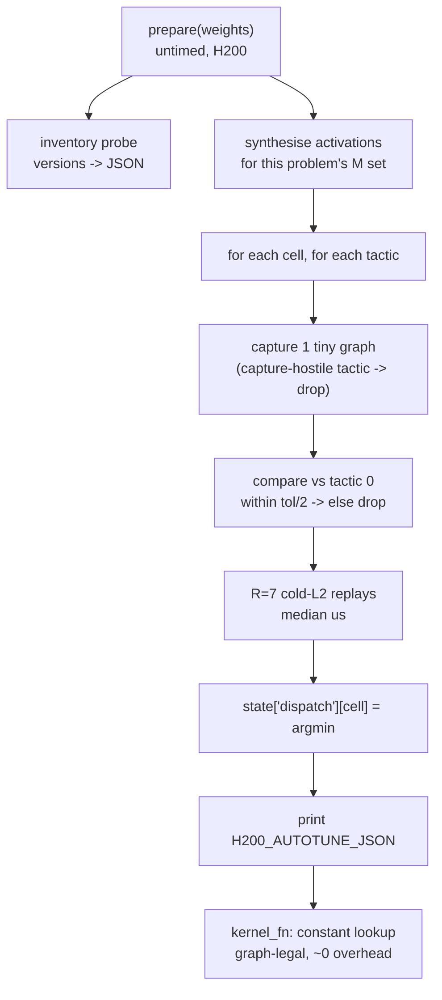

# feat: H200 on-device `prepare()` autotuner, measured tactic families, and the four-front kernel sprint

## Summary

Turn one `okc check` into a tournament: inside the untimed `prepare(weights)` window every
candidate benchmarks a registered set of competing tactics per scored cell on the real H200,
verifies each against the incumbent's numbers, binds the fastest winner per cell, and prints a
machine-readable latency table that `okc status --json` hands back. Because the incumbent
(`baseline.py`'s own call) is always tactic 0, a candidate can no longer land below `1.0x` on a
cell by picking a slower kernel. Around that multiplier: land the already-measured rows, then
work tactic families in measured order — FA3 parameters, Marlin block size, cublasLt algorithm
selection — and only then the two custom kernels.

---

## 0. Corrections to the brief (read before executing)

The brief's architecture is accepted; six of its factual premises are not. Each wrong premise
would have cost a check or a Colab session, so they are resolved here rather than in execution.

| # | Brief says | Repo says | Consequence |
|---|---|---|---|
| C1 | `baseline.py` builds `get_scheduler_metadata` only for `L=1` full loads, so we precompute it for sliding/verify | `problems/muse_decode_layer/reference.py:_fa3_scheduler_metadata` builds it, and `TASK.md` states `None` on sliding layers and verify blocks is SGLang parity, not an omission | A candidate cannot add it: it allocates and branches on `cache_seqlens` **inside the captured `kernel_fn`**, which TASK.md forbids twice over ("no allocating", "no branching on input values"). Drop this from B1. |
| C2 | The FP8 warp MMA is "testable on A100 `sm_80`" | `mma.sync.aligned.m16n8k32...e4m3` is `sm_89`+. A100 is `sm_80` and has no FP8 tensor cores | A100 is a bandwidth/counter gate only. FP8 numerics belong on the L4. A kernel whose PTX needs `sm_89` will not even compile for `sm_80`. |
| C3 | Give the autotuner a wall-clock deadline (`time.monotonic`) | `verifier_static.BANNED_MODULE_ATTRS` bans `time.time`, `time.perf_counter`, `time.monotonic` module-wide | The budget is a **fixed trial count** per cell, not a deadline. Deterministic, and cheaper to reason about. |
| C4 | Cap autotuning at 120–180 s inside `prepare()` | `TASK.md`: 300 s for `prepare()`, but the whole run has **15 minutes including compilation**; `colab_runner.DEFAULT_BUDGETS = {"prepare_s": 180.0}` is the local Tier-1 cap | Budget **≤ 20 s** of trials. 180 s of autotune in a 15-minute run with 13 correctness cases plus 12 paired-replay shapes is how a run times out and is charged. |
| C5 | `MILESTONE_FLOOR` still sits at the top-50 cutoffs; lower it to 1.05 everywhere | Already `{bf16_proj: 1.08, attention: 1.15, moe: 1.15, decode_layer: 1.15, prefill: 1.50}` (`src/okc_loop/auto_submit.py`) | Nothing to lower by default. `muse_decode_layer` at a measured `1.1604x` already clears 1.15. A per-problem floor is lowered only **after** a check measures `>= 1.05` and no row exists — the precedent that produced the 1.08 entry. `AGENTS.md` mandates `>= 1.15`; a blanket 1.05 contradicts the repo rule for no gain. |
| C6 | Marlin's `moe_align_block_size` is stuck at 8/16, causing the 804 MB re-read | `BLOCK_SIZE_M_CANDIDATES = (8, 16, 32, 48, 64)` with a per-call density heuristic (`num_tokens*TOP_K/LOCAL_EXPERTS/block_size_m < 0.9`) in all three MoE baselines | C1 is "replace a heuristic with a measured per-M table", a one-afternoon change, not "unlock a knob". Smaller unit, same lever. |

Two claims kept as-is because they are verified: the cold-L2 protocol is already implemented at
Tier-1 (`colab_harness.Graphs(flush_bytes=256 << 20)`, zeroed before every timed replay), and the
judge's `log_tail` does return the last 16 000 characters of what a run prints — so
`H200_AUTOTUNE_JSON:` is a real telemetry channel, already surfaced as
`profiler_parser.Report.log_tail`.

**Monotonicity, stated honestly.** Binding `argmin_t median_us` per cell cannot make a cell
*slower than the winner we measured*, but it is not a mathematical guarantee of
`>= baseline`: the judge times through the captured graph and subtracts ~4 µs of replay cost from
both sides, and it reports the median of paired ratios. Selection is therefore
"monotone up to prepare-time measurement noise", and the plan's per-tactic numeric guard plus the
gate's `MAX_LOAD_REGRESSION = 1.05` are what actually catch a bad pick. Do not claim strict
monotonicity in any commit message.

---

## Problem Frame

Four days left, 18 unused checks/day/problem, ~336 Colab CU. The loop's own history says where it
stands:

- `muse_bf16_proj` on the board at **1.0970x**; `#50` is now **1.5718x** — a 1.43x climb.
- `muse_decode_layer` best measured **1.1604x** (job `2b88adde51864e41`), `#50` 2.2252x, and the
  wrapper ceiling with Marlin/FA3/cuBLAS intact is ~1.24x.
- `muse_attention_decode` and `muse_moe_w4a16`: nothing uploaded; wrapper ceilings 1.348x / 1.253x
  against `#50` lines of 2.677x / 2.420x.

Every failed candidate so far was a *single static tactic* tried against a whole problem: a
hand GEMM at `0.7977x`, a GEMV at `0.8086x`, a generated W4A16 at `0.0927x`. Each burned a check
and returned one scalar. The missing instrument is a way to measure many tactics per check and to
never lose a cell to a tactic that is simply slower. `prepare()` is that instrument: 300 untimed
seconds on the same bare-metal H200 the judge times on.

---

## Requirements

- **R1. One check, many tactics.** A candidate benchmarks a registered tactic set per scored cell
  inside `prepare()` and binds per-cell winners, keeping `baseline.py`'s own call as tactic 0.
- **R2. Telemetry.** Every autotuned run emits `H200_AUTOTUNE_JSON:<json>` on stdout; the loop
  parses it from `log_tail` and records it against the job in the ledger.
- **R3. Safe budget.** Total trial time ≤ 20 s per `prepare()`, fixed trial counts (no clock), so
  no run approaches the 15-minute cap and no run depends on `time.*`.
- **R4. Numeric guard.** A tactic may be bound only if its output matches tactic 0 within a
  fraction of the problem's own documented tolerance, checked in `prepare()` without importing
  `reference`/`checks`.
- **R5. Rows first.** Every problem gets a live row whose `okc check` clears the untouched
  `MILESTONE_FLOOR` rule; floors change only per problem, only after a measurement.
- **R6. Tactic families are measured, not asserted.** Each family enters the tournament only with
  an L4-clean candidate and, for custom CUDA, a bandwidth number at Tier-1/1B (≥ 55% of A100
  sustained peak on a memory-bound cell, or it beats the A100 baseline on that cell).
- **R7. Honest ceilings.** Attention and MoE work is reported against their wrapper ceilings
  (1.348x / 1.253x); no unit promises a board line those ceilings exclude.

---

## Scope Boundaries

- No new GEMM from scratch. Three hand-written dense GEMMs (CUDA-core GEMV, wmma+`cp.async`,
  TMA+`wgmma`) are measured losses on the judge; only `cublasLt` *algorithm selection* is in scope
  for the dense cells.
- No `scheduler_metadata` construction, no KV-cache layout change, no precision change
  (weights stay BF16/NVFP4, activations stay BF16, KV stays FP8, queries may round to FP8).
- No change to `assert_automated`, the human-only list, or the ledger's quota model.
- The generator (`generator.py`) is not used to write any kernel in this plan; it stays a
  mechanical splicer.
- `muse_prefill_layer` stays untouched (its floor is 1.50 and nothing is measured against it).

---

## Context & Research

### Relevant code and patterns

- `src/okc_loop/auto_submit.py` — `MILESTONE_FLOOR`, `MIN_GAIN = 0.015`,
  `MAX_LOAD_REGRESSION = 1.05`, `evaluate()`, `record_upload()`.
- `src/okc_loop/verifier_static.py` — Tier-0. Graph safety walks only the call graph reachable
  from `kernel_fn` (`_check_graph_safety`), so `prepare()` may allocate, sync and read values;
  `BANNED_MODULE_ATTRS` / `BANNED_IMPORTS` still apply module-wide.
- `src/okc_loop/colab_harness.py` — `Graphs.capture/timed` (256 MB cold-L2 flush, two-graph
  mutation replay), `candidate_module` (needs a real file for Triton), `compile_sm90a`.
- `src/okc_loop/colab_runner.py` — `VALID_GPUS = ("L4", "A100", "G4", "H100")`,
  `TIER2_GPU = "A100"`, `DEFAULT_BUDGETS`.
- `src/okc_loop/profiler_parser.py` — `Report.log_tail`, populated from the job payload; the
  parse point for `H200_AUTOTUNE_JSON`.
- `src/okc_loop/synthesizer.py` — the existing precedent for emitting a whole candidate file from
  source fragments (and re-running Tier-0 on its own output).
- `src/okc_loop/candidates/decode_layer/composite.py` — the current `muse_decode_layer`
  candidate (`_SGL` guard, fused prologue, fused post-expert finalize, stacked router).
- `problems/muse_decode_layer/baseline.py` — `_gemm` = `_bf16_gemm_dispatch_impl`, `_experts`
  Marlin block-size heuristic at line 243, FA3 call at line ~300 with `descriptor` kwargs.
- `problems/muse_decode_layer/reference.py:227` — `_fa3_scheduler_metadata` (see C1).

### Institutional learnings

- `docs/PROGRESS.md` — the L4 cannot rank a compute-heavy kernel against the H200 (the GEMV that
  measured 61–69% of L4 peak lost 5x on the judge); a `prepare()` that fails to build must
  **raise**, never fall back (the silent-fallback trap); `-arch=sm_90a` alone fails because
  torch appends a `-gencode` set — use `--generate-code=arch=compute_90a,code=sm_90a`.
- `AGENTS.md` — floor 1.15, `MAX_JOBS=1`, parent never imports torch, cold-L2 is real (no L2
  residency tricks).

### External references

- `flash_attn_with_kvcache` (`sgl_kernel.flash_attn`) parameters: `pack_gqa`, `num_splits`,
  `sm_margin`, `scheduler_metadata`.
- `cublasLt`: `cublasLtMatmulAlgoGetHeuristic`, `CUBLASLT_ALGO_CONFIG_SPLITK_NUM`,
  `CUBLASLT_ALGO_CAP_SPLITK_SUPPORT`.
- Programming-guide facts that C2 rests on: `mma.m16n8k32` with `e4m3` inputs requires `sm_89+`.

---

## Key Technical Decisions

1. **Tactic selection lives in `prepare()`, not in the engine.** Two variants of the same kernel
   differ only by a dispatch table entry; `kernel_fn` reads `state["dispatch"][key]` — a constant
   lookup, graph-legal, no allocation, no value branching.
2. **Tactic 0 is always the incumbent call, and it is timed the same way.** The tournament is an
   argmin over *measured* medians, with the baseline's own path as a candidate, so a cell cannot
   be bound to something slower than what the baseline would have done.
3. **Per-tactic graphs, timed like the judge.** Each trial is captured (`torch.cuda.graph`) and
   timed by replay with a 256 MB L2 flush, matching `Graphs.timed`. This also rejects
   capture-hostile tactics (allocation inside replay) *before* they can be selected.
4. **Fixed trial counts, no clocks.** `R = 7` timed replays per trial, tactics capped per cell
   (~24) and cells capped per problem (~12) — worst case a few thousand replays, well under 20 s
   at 10–700 µs each. No `time.*` (banned), no data-dependent loop counts.
5. **One implementation, emitted into candidates.** Candidates are single files shipped to the
   judge and cannot import `okc_loop`. The autotuner is authored once in
   `src/okc_loop/candidates/autotune.py` as a source-emitting template (like `synthesizer.py`),
   and every candidate file carries the emitted block. Tier-0 runs on the emitted source.
6. **Tactic families are ordered by measured share, then by code cost.** FA3 parameters (no new
   kernel, ~40 lines) and Marlin block size (a dict) first; `cublasLt` algorithm sweep (a C++
   `load_inline` wrapper) second; custom CUDA last.
7. **A container inventory probe rides along in the first autotuned `prepare()`.** It prints
   `importlib`-free presence checks (`flashinfer`, `deep_gemm`, `sgl_kernel` versions) into the
   same JSON. This converts the brief's unverified "the image ships X" claims into a measurement
   for free, before any work depends on them.
8. **Floors change per problem, only after a measurement** (C5). `muse_decode_layer` submits at
   1.1604x now; nothing else moves until a check says otherwise.

---

## High-Level Technical Design

> Directional guidance, not implementation specification.



Data path after the check: `okc status <job> --json` → `profiler_parser.Report.log_tail` →
`autotune.parse_table(log_tail)` → ledger `events` row (`kind="autotune.table"`, problem, sha,
job) → read by the operator and by `cli status`. No schema change.

---

## Implementation Units

### U1. `PrepareAutotuner` core and its telemetry

**Goal:** One emitted source block that benchmarks tactics per cell in `prepare()` under the
judge's own capture/cold-L2 semantics, guards them numerically, binds winners, and reports; plus
the loop-side parser that turns that report into ledger rows.

**Requirements:** R1, R2, R3, R4

**Dependencies:** none

**Files:**
- Create: `src/okc_loop/candidates/autotune.py`
- Create: `tests/test_autotune.py`
- Modify: `src/okc_loop/profiler_parser.py` (parse `H200_AUTOTUNE_JSON:` out of `log_tail`)
- Modify: `src/okc_loop/cli.py` (`status` shows the parsed table when present)
- Test: `tests/test_profiler_parser.py` (fixture carrying a `log_tail` with the marker)

**Approach:**
- `autotune.emit(...)` returns the Python source of the block, inserted into a candidate by
  `synthesizer`-style splicing; the block's public surface is
  `def _autotune_bf16(weights, cells, tactics, budget) -> dict` and friends, all prefixed so the
  spliced file has no collisions.
- Per trial: build the graph once, verify against tactic 0's output (relative L2, threshold =
  half the problem's documented bound), then time `R = 7` replays with a 256 MB flush; take the
  median. Drop on guard failure or on capture failure.
- `MAX_TRIALS_PER_CELL = 24`, `CELLS <= 12`, `R = 7` are counts, not seconds (C3/R3).
- Selection is `min(range(n), key=medians.__getitem__)` — plain Python, so the banned
  `argmin/topk` call names never enter the reachable graph.
- The block prints exactly one line: `print("H200_AUTOTUNE_JSON:" + json.dumps(summary))`.
  `json` is legal (not banned); keep the payload to `{cell: {tactic: [median_us, ok]}}`.
- Version probe: `import flashinfer` / `import deep_gemm` / `import sgl_kernel` inside
  `try/except ImportError` in the block, reporting `version` (or `None`) — no `importlib`, no
  `sys.modules` (both banned).

**Technical design:** the binding contract every later unit writes against:

```
state["dispatch"] = { "qkv_gate:m=1": ("cublas", None), "router:m=1": ("stacked_mm", None), ... }
kernel_fn:      spec = state["dispatch"][f"{layer}:m={m}"]   # constant dict lookup
```

**Patterns to follow:** `synthesizer.synthesize` (emit source, then Tier-0 the result);
`colab_harness.Graphs` (flush + capture semantics to mirror).

**Test scenarios:**
- Happy path: `emit()` output passes Tier-0 for `muse_decode_layer` and `muse_bf16_proj`, and its
  pure helpers (`_median`, guard decision, argmin choice) produce the expected winner when exec'd
  against a stub namespace where "tactic 2" is fastest.
- Happy path: `parse_table()` returns all cells/tactics from a synthetic `log_tail` containing a
  truncated prefix, the marker line, and the judge's trailing text.
- Edge case: a tactic whose guard rel-L2 is exactly at threshold/2 passes; threshold/2 + 1e-9
  drops.
- Error path: no marker in `log_tail` → `parse_table` returns `None` (not an exception), and
  `cli status` prints "no autotune table".
- Error path: an emitted block containing `time.monotonic` fails Tier-0 (pins C3 as a regression).

**Verification:** a Tier-1 L4 run of a trivially autotuned `muse_bf16_proj` candidate prints the
marker with two tactics per cell, and `cli status <job>` renders the table; ledger has one
`autotune.table` event.

---

### U2. Rows first: reconcile live state, then upload

**Goal:** Know exactly what is on each board and submit the measured decode-layer row; stop
guessing about the in-flight submit.

**Requirements:** R5

**Dependencies:** none

**Files:**
- Modify: `src/okc_loop/auto_submit.py` (only if a per-problem floor is justified by a fresh
  measurement — comment must carry the job id and the number)
- Test: `tests/test_orchestrator_and_autosubmit.py` (floor lookup + the "measured but below floor" case)

**Approach:**
- Reconcile: `muse_decode_layer` has check `2b88adde51864e41` = **1.1604x** and a submit dispatch
  `952d7ba4696243fa` whose outcome is not in `problem_scores`. Read it with
  `okc status 952d7ba4696243fa --json` before anything else; a duplicate check of the same bytes
  returns `status: duplicate` and does not re-time.
- If the submit succeeded, `personal_best` gains `muse_decode_layer`; if it failed, re-submit the
  same sha (it clears 1.15 already).
- Then port the two verified transfers named in `docs/PROGRESS.md` into
  `muse_attention_decode` (1-launch attention prologue + fused `rms_norm_gate`) and
  `muse_moe_w4a16` (all-`T` fused post-expert finalize), one check each, and submit whichever
  clears its floor. Do **not** lower a floor to make a candidate fit; if a check measures 1.0–1.15
  and no row exists, record the number in `docs/PROGRESS.md` and carry it into U3/U4 instead.

**Patterns to follow:** `auto_submit.candidate_from_check` → `evaluate` → `record_upload`;
`cli check`'s quota path.

**Test scenarios:**
- Happy path: a `Candidate` at 1.1604x against an empty incumbent with floor 1.15 → `allowed`.
- Edge case: 1.10x on a problem with no row and floor 1.15 → refused with `failed="gain"`,
  and the reason names the measured number.
- Integration: `record_upload` moves `personal_best` and writes one `autosubmit.decision` event.

**Verification:** `okc leaderboard muse_decode_layer` shows `you` with a rank; `personal_best`
has a decode-layer row.

---

### U3. Tactic family B1 — FA3 invocation sweep

**Goal:** Recover FA3's under-utilised SMs on the small/odd loads by sweeping only parameters a
candidate can legally change, and bind the winner per load shape.

**Requirements:** R1, R6, R7

**Dependencies:** U1

**Files:**
- Modify: `src/okc_loop/candidates/decode_layer/composite.py` (FA3 call behind `state["dispatch"]`)
- Create: `src/okc_loop/candidates/attention_decode/attn_params.py`
- Modify: `src/okc_loop/candidates/{decode_layer,attention_decode}/variants.py` (register the family)
- Test: `tests/test_decode_layer_candidates.py`, create `tests/test_attention_decode_candidates.py`

**Approach:**
- Sweep axes: `pack_gqa in (True, False)`, `num_splits in (0, 2, 4, 8, 16)`,
  `sm_margin in (0, 4, 8)`, and contiguous `[B, H_kv]` descale tensors instead of
  `.reshape(1,1).expand(...)`. 2×5×3 is too many per cell; prune to `pack_gqa × num_splits` (10)
  and time `sm_margin` only where the sweep found a split winner (≤ 2 extra).
- **Not swept:** `scheduler_metadata` (C1 — illegal inside capture). Sliding and verify cells run
  with whatever the harness supplied, which is `None`, as SGLang does.
- Tactic 0 = the baseline's exact call (defaults, expanded descale).
- Guard: attention output rel-L2 vs tactic 0 must stay under half the load's documented bound;
  split changes reorder FP32 accumulation, so this guard is the only thing between a "faster"
  split and a correctness failure on `verify 32 full`.
- This family is also the decode-layer cell binder for FA3 — the same table is reused by U8.

**Patterns to follow:** the `_SGL` guard in `composite.py` — every new call must fall back to a
torch path on the L4 so Tier-1 can still pass.

**Test scenarios:**
- Happy path: dispatch lookup for `(batch=32, q_len=1, window=16)` selects the tactic recorded as
  fastest in a synthetic table; a different key selects a different tactic.
- Edge case: table missing a key → falls back to the default FA3 call (never raises inside
  `kernel_fn`).
- Error path: guard fails on `num_splits=16` → that tactic is absent from the emitted table.
- Integration: emitted candidate still passes Tier-0, and Tier-1 confirms the torch fallback path
  at `_SGL = False`.

**Verification:** one autotuned check on `muse_attention_decode` prints a table where at least one
cell shows a tactic faster than tactic 0, and the scored loads improved on that cell.

---

### U4. Tactic family C1 — measured Marlin block size, plus the container inventory

**Goal:** Replace the `< 0.9` density heuristic for `moe_block_size` with a per-`M` table measured
on the H200, and read the container's real optional-backend inventory.

**Requirements:** R1, R6, R7

**Dependencies:** U1

**Files:**
- Modify: `src/okc_loop/candidates/decode_layer/composite.py` (`_experts` block-size choice)
- Create: `src/okc_loop/candidates/moe_w4a16/marlin_block.py`
- Modify: `src/okc_loop/candidates/{decode_layer,moe_w4a16}/variants.py`
- Test: `tests/test_decode_layer_candidates.py`, `tests/test_candidates.py`

**Approach:**
- Table over `M in (1, 8, 16, 32, 128, 256)` × `block_size_m` in the baseline's own
  `BLOCK_SIZE_M_CANDIDATES`; bind nearest bucket, monotone in `M` (the synthesizer's anti-overfit
  rule: no exact-`m` membership tests).
- Inventory from U1's probe decides whether `flashinfer`/`deep_gemm` backends are even candidates;
  the brief's signatures are unverified, so nothing is written against them until a check reports
  the version. If present, a backend becomes one more tactic (never the only tactic).
- Guard: MoE output rel-L2 vs tactic 0 (tolerance from TASK.md: 8% cache, routing rules
  unchanged) — routing must stay identical, so the guard compares `topk_ids` equality too.
- Reuse: the same table feeds `muse_moe_w4a16` (same baseline block).

**Patterns to follow:** `baseline._experts` — keep `moe_align_block_size`, Marlin, `silu_and_mul`
and the fused finalize byte-identical; only the chosen `block_size_m` varies.

**Test scenarios:**
- Happy path: `M=256` selects the bucket whose measured median was lowest in a synthetic table;
  `M=33` takes the `M=32` bucket.
- Edge case: table empty (no autotune ran) → the baseline heuristic's result, so the candidate is
  never worse than baseline by construction.
- Error path: a tactic whose `topk_ids` differ from tactic 0 is dropped even if faster.
- Integration: Tier-0 clean; Tier-1 passes with `_SGL = False` where the table is bypassed.

**Verification:** an autotuned `muse_moe_w4a16` check prints block-size medians per `M`; the
inventory section shows which optional backends exist in the image.

---

### U5. Tactic family D1/D2 — `cublasLt` algorithm × Split-K sweep, and a PDL router epilogue

**Goal:** Beat `torch.mm`'s default heuristic on the dense cells without writing a GEMM: pick a
better `cublasLt` algorithm/`SPLITK_NUM` from a measured sweep, and replace the serial atomic
reduction in the one hand kernel that already wins (`router` at `m <= 8`).

**Requirements:** R1, R6

**Dependencies:** U1

**Files:**
- Create: `src/okc_loop/candidates/bf16_proj/cublaslt_sweep.py`
- Modify: `src/okc_loop/candidates/bf16_proj/kernel_wide_tma.py` (router path only)
- Modify: `src/okc_loop/candidates/bf16_proj/variants.py`
- Test: `tests/test_bf16_proj_candidates.py`

**Approach:**
- `load_inline` C++ wrapper: `cublasLtMatmulAlgoGetHeuristic(requestedAlgoCount = 128)` with a
  pre-allocated workspace, then per algorithm override `CUBLASLT_ALGO_CONFIG_SPLITK_NUM` over
  `(1, 2, 4, 6, 8, 12, 16)` where the capability bit allows. Every `(algo, splitk)` becomes one
  tactic. This is the only new lever with a *plausible* mechanism for the 1.5–2.1x gap to floor:
  the same `nvjet` kernels, chosen under cold L2 instead of cuBLAS's warm-L2 heuristic.
- If the sweep finds nothing better than tactic 0 on every wide cell, **stop**: record it in
  `docs/PROGRESS.md` as the fourth measured loss on this problem and spend no more checks there.
  That is the unit's kill criterion, not a failure.
- D2: keep `kernel_wide_tma` as a router-only tactic; replace `__threadfence()` + single-CTA
  serial reduction with a two-stage PDL reduction (`cudaLaunchKernelEx` +
  `cudaLaunchAttributeProgrammaticStreamSerialization`) that also sums the `hi + lo` halves in
  FP32 in one pass. Router-only, `m <= 8`, where it already measured 7.87 vs 8.75 µs.
- Workspace and algo descriptors are built in `prepare()`; `kernel_fn` only calls the fixed plan.

**Patterns to follow:** `kernel_wide_tma.py`'s existing `prepare()` build-and-raise (never silent
fallback), and its `--generate-code=arch=compute_90a,code=sm_90a` fix.

**Test scenarios:**
- Happy path: with a stub `cublasLt` shim returning three algorithms, the sweep emits exactly
  three tactics and the selector binds the fastest; PDL stage 2 sums `S_K` partials equal to a
  float64 reference within 1e-3 relative.
- Edge case: no algorithm advertises Split-K → the sweep degenerates to a single `algo` tactic and
  still binds something (never zero tactics).
- Error path: `load_inline` build failure raises out of `prepare()` on an `sm_90` device
  (regression pin for the silent-fallback trap).
- Integration: `muse_bf16_proj` emitted candidate passes Tier-0 and Tier-1 with the cuBLAS
  fallback where the extension is absent.

**Verification:** one `muse_bf16_proj` check prints a table with ≥ 20 `(algo, splitk)` rows per
wide cell; either a wide cell beats 1.00x, or the kill criterion is recorded with numbers.

---

### U6. Custom kernel B2 — both-KV-head paged FP8 GQA for the small attention loads

**Goal:** A decode-path kernel that reads the 128-byte KV cache line once for both KV heads and
computes `QK^T` natively in FP8, targeted only at the loads where FA3 is 11–12x off floor.

**Requirements:** R6, R7

**Dependencies:** U1 (as a tactic), U3 (needs the FA3 winner as tactic 0 to beat on those cells)

**Files:**
- Create: `src/okc_loop/candidates/attention_decode/kernel_paged_fp8.py`
- Modify: `src/okc_loop/candidates/{attention_decode,decode_layer}/variants.py`
- Test: `tests/test_attention_decode_candidates.py`, `tests/test_decode_layer_candidates.py`

**Approach:**
- Design is the brief's, kept: one CTA per `(batch, kv_split)` covering both `h_kv` heads; 8
  threads issue `uint4` loads to cover the whole 128-byte line; `mma.sync.aligned.m16n8k32` for
  `QK^T` (FP8) and `m16n8k16` for `PV` (BF16 after in-register conversion); split-KV combine fuses
  `rmsnorm_1e-8(a) * sigmoid(gate)`.
- Constraints: `page_size` 1 *and* 64 must work (1 scored, 64 tested) and `kv_scale` 1/64 must be
  honoured — the kernel takes the descale as a tensor, never folded.
- Only the small loads get the kernel; FA3 stays tactic 0 elsewhere and remains tactic 0 here too,
  so a bad kernel loses a cell, not the run.
- Gate before any H200 check: Tier-1 L4 correctness (13/13 tests, both graph-mutation replays) and
  a bandwidth number — `bytes/time` ≥ 55% of A100 sustained peak on the `decode 1` cell
  (goal-proxy for H200's 36 GB/s/SM; A100 is 3.7x closer to it than the L4's 5 GB/s/SM). FP8 PTX
  will not compile for `sm_80`; run the A100 pass with the FP8 MMA block compiled for `sm_89` via
  `TORCH_CUDA_ARCH_LIST=8.9+PTX` only if it loads, otherwise take the L4 number and say so.
- If the gate fails, the kernel is retired with the number recorded. Expected honest outcome:
  `muse_attention_decode` reaches ~1.25–1.35x (wrapper + FA3 params), not 2.677x.

**Patterns to follow:** `_SGL`-guarded candidate layout; the split-KV structure FA3 itself uses;
`colab_harness.compile_sm90a` for the spill check (0 spills at `-Xptxas=-v`).

**Test scenarios:**
- Happy path: `page=64`, `kv_scale=1.0`, windowed sliding: output rel-L2 within the load's bound
  and the mask never admits `t < 0` (the clamped-index bug in `docs/PROGRESS.md`).
- Edge case: `page=1`, `kv_scale=1/64` (the tested variants) — descale applied, no NaN/Inf.
- Edge case: `batch=1` (a single stream) and `batch=32` (64 streams) both bind, and the split
  count comes from the table, not from a value read at runtime.
- Error path: a tiny `ctx=10` context where the window starts below 0 → still matches the
  reference.
- Integration: capture + timed replay at the judge's protocol on L4 (two graphs, in-place
  mutation) reproduces the eager result.

**Verification:** either a check where the small attention loads improve while every other cell
stays at tactic 0, or a recorded Tier-1 bandwidth failure with the number that justified retiring
it.

---

### U7. Custom kernel C2 — active-expert-only W4A16 for `M <= 8` (conditional)

**Goal:** Make `decode 1` / `verify 1` MoE time track the 2–8 live routes instead of two full
Marlin grid passes.

**Requirements:** R6, R7

**Dependencies:** U4 (needs the block-size table and the inventory result)

**Files:**
- Create: `src/okc_loop/candidates/moe_w4a16/kernel_active_w4a16.py`
- Modify: `src/okc_loop/candidates/{moe_w4a16,decode_layer}/variants.py`
- Test: `tests/test_decode_layer_candidates.py`

**Approach:**
- Only worth attempting if U4's inventory shows no usable preinstalled backend **and** U6's gate
  work has already landed: this is the lowest-confidence kernel in the plan (a from-scratch
  NVFP4 expert GEMM is the exact thing two measured attempts lost at 10x and 40x).
- Scope it to `M <= 8` with a device-side compacted route list, `E2M1` dequant through a
  register LUT (`__shfl_sync`), paired `gate`/`up` rows in one CTA so `silu(gate)*up` never hits
  HBM, and the `(1 + post_norm_w)` RMSNorm fused into the reduction.
- Same gates as U6: L4 correctness first, then ≥ 55% of A100 sustained peak on the cell, then one
  tactic slot in the H200 tournament. Never the only path for any cell.
- Expected honest outcome: no measurable win. The plan's value here is a measured answer for
  `decode 1`/`verify 1` instead of another inference.

**Test scenarios:**
- Happy path: `M=1` with a synthetic routing where 2 of 32 local experts are live → output matches
  tactic 0 within the MoE bound, and the kernel's traffic equals 2 experts' bytes (assert the byte
  count, not the time).
- Edge case: all 32 experts live at `M=8` → still correct (the compaction is not assumed small).
- Error path: zero live routes → returns zeros without a launch of the expert GEMM.
- Integration: unfinished routes above the `M <= 8` threshold fall through to Marlin (tactic 0).

**Verification:** a table row for `decode 1` showing either a win or the retirement number.

---

### U8. Decode-layer synthesis and submit

**Goal:** Merge the winning tactics from U3/U4/U5 into one `muse_decode_layer` candidate and put
the best number on the board.

**Requirements:** R1, R5, R7

**Dependencies:** U2, U3, U4, U5

**Files:**
- Modify: `src/okc_loop/candidates/decode_layer/composite.py` (final merged dispatch table)
- Modify: `src/okc_loop/candidates/decode_layer/variants.py`
- Test: `tests/test_decode_layer_candidates.py`

**Approach:**
- The merged candidate is the same file with a larger `dispatch` table; every table entry is a
  measured median from an earlier check, and the JSON from each contributing job is cited in a
  comment beside each constant (the repo rule: every non-obvious constant names its measurement).
- `synthesizer.anti_overfit_findings` must stay empty: ranges, not exact-`m` membership.
- Submit through `auto_submit.evaluate`; progression rule unchanged (`MIN_GAIN`).
- Ceiling discipline: state the wrapper ceiling for the measured candidate (~1.24x) in the commit
  body; if the merged check lands inside the CI of the incumbent, stop merging and keep the
  incumbent.

**Test scenarios:**
- Happy path: a dispatch table with overlapping or unsorted keys raises at import (fail fast on
  the judge is unacceptable).
- Edge case: unknown `m` (nearby shapes) → nearest bucket below, exact `M` from the scored set.
- Integration: merged `prepare()` still raises on a failed extension build on `sm_90`.

**Verification:** `okc leaderboard muse_decode_layer` shows the new row; ledger has the check and
the submit decision.

---

## System-Wide Impact

- **Interaction graph:** `prepare()` gains GPU work — it now allocates graphs, workspaces and
  synthetic activations on top of weight repacking. Peak GPU memory moves up by
  `flush (256 MB) + activations (≤ 300 MB) + one captured graph`; the `verify 32` loads already
  run near `muse_decode_layer`'s footprint, so memory is the first thing to check when a run
  fails at prepare.
- **Error propagation:** a tactic that fails its guard is dropped silently *by design* (recorded
  in the JSON); a build failure or an empty table must raise, never fall back (the silent-fallback
  trap cost a check).
- **State lifecycle:** `state["dispatch"]` is written once in `prepare()` and read in `kernel_fn`
  with a constant key — no per-call mutation, so graph capture stays legal.
- **API surface parity:** the parser change in `profiler_parser` is additive (`Report.autotune`),
  and `cli status` degrades to today's output when the marker is absent.
- **Unchanged invariants:** Marlin/FA3/cuBLAS kernels stay byte-identical where they are tactic 0;
  `assert_automated`, the human-only list, quota accounting and the ledger schema are untouched.

---

## Risks & Dependencies

| Risk | Mitigation |
|---|---|
| `prepare()` autotuning blows the 15-minute run cap | Fixed trial counts (`≤ 24`/cell, `≤ 12` cells, `R=7`), targeting ≤ 20 s worst case; measured in the first autotuned check's `prepare_s` |
| Prepare-time medians mis-rank a tactic vs the judge's paired-ratio timing | Tactic 0 is measured identically; guard + `MAX_LOAD_REGRESSION = 1.05` catch a bad bind; no strict-monotonicity claim |
| Judge screens autotuning in `prepare()` as suspicious | It is not timing manipulation: no harness reads, no clock, no input-value branching; all `prepare()` output is a constant table |
| A captured tactic allocates inside replay | Every trial is captured and replayed in `prepare()`, so capture-hostile tactics drop before selection |
| `cublasLt` sweep finds nothing (likely) | Explicit kill criterion: record, stop, spend no further bf16_proj checks |
| FP8 attention kernel cannot be rank-checked on A100 (C2) | L4 correctness + `bytes/time` SoL gate; A100 only where the PTX loads |
| Colab CU exhaustion on custom kernels | One L4 run per candidate (correctness) and at most one A100 pass per kernel; 336 CU is ~50 A100 hours |
| Autotune table drifts between checks | Tables are cited per constant in source; a merged candidate carries the job id of each number |

---

## Documentation / Operational Notes

- `docs/PROGRESS.md` gains a section per unit with the measured table and the job id; the
  "Next (in order)" list is rewritten to match this plan's U-IDs.
- `AGENTS.md` is on the must-not-edit list; any doc mismatch (e.g. the 1.15 rule) is recorded in
  `docs/PROGRESS.md`, not edited there.
- `cli status` prints the autotune table when present; that is the operator's view between
  checks and is what makes a check worth reading twice.

---

## Sources & References

- Plan predecessor: `docs/plans/2026-10-30-001-feat-okc-verifiable-kernel-loop-plan.md` (M1–M4,
  R2, R5, R9, U5–U8).
- `docs/PROGRESS.md` — all measured numbers quoted above.
- `AGENTS.md` — the two rules, the protected-kernel facts, the tier roles.
- `problems/muse_decode_layer/{TASK.md,baseline.py,reference.py}` — contract, timing rules,
  `_fa3_scheduler_metadata`, block-size heuristic.
